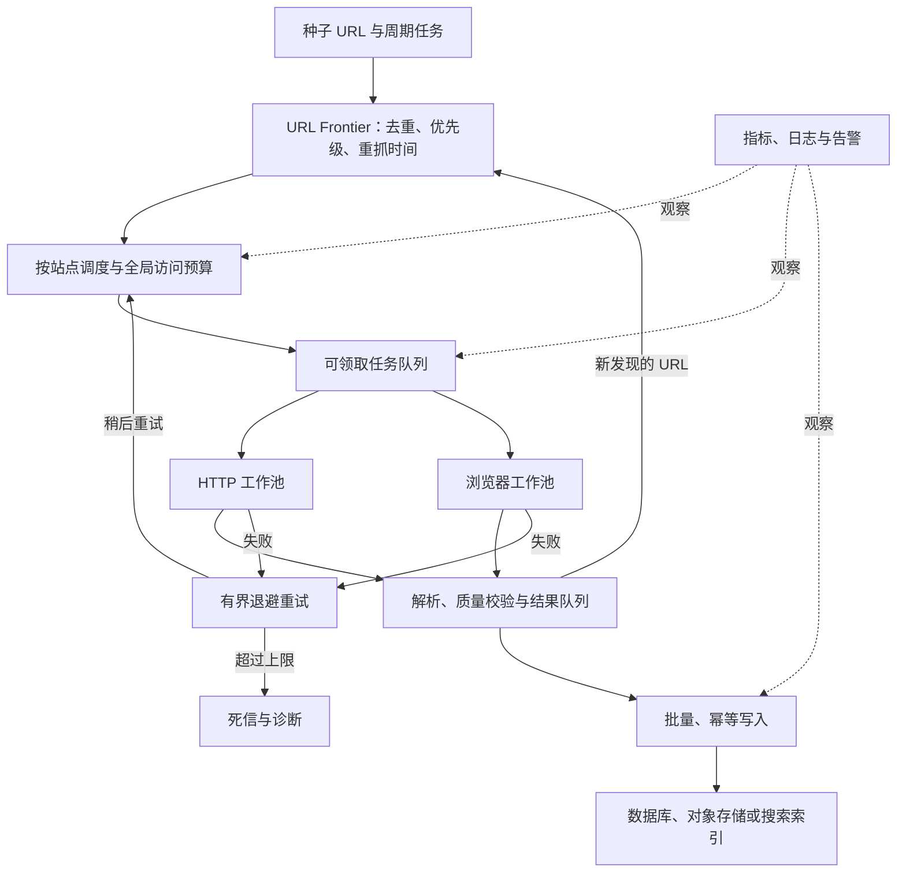
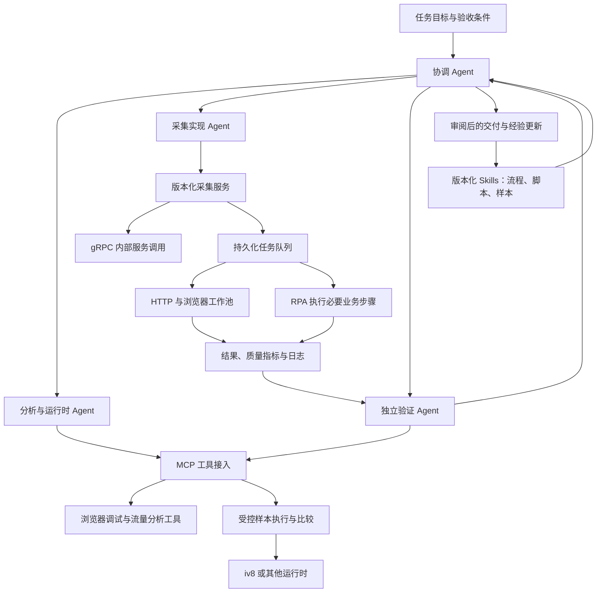
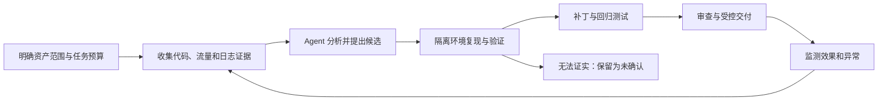

# Web 爬虫技术演变全景：从数据采集到可靠工程与 AI 协作

> 前沿补缺版：2026-09-08。资料核验范围和版本见附录 C；技术历史中的“八代”按主题阅读，不是统一分期。本文围绕正确、完整、及时且成本可控的数据交付组织内容。

## 引言与阅读路线

Web 采集涉及访问机制、字段提取、调度执行、数据存储和持续验证。反爬与安全问题是其中的重要边界；日常任务仍应首先确认数据来源、用途和质量要求，再选择必要技术。

OWASP 将 Scraping 列入 OAT-011 自动化威胁分类，用于讨论应用受到的风险；这不意味着所有采集用途都属于恶意行为。[OWASP OAT-011](https://owasp.org/www-project-automated-threats-to-web-applications/assets/oats/EN/OAT-011_Scraping)。

| 阅读任务               | 建议路线                                                                                       | 读后应有产物                         |
| ---------------------- | ---------------------------------------------------------------------------------------------- | ------------------------------------ |
| 首次建立稳定采集       | [能力地图](#ch-3) → [提取与增量](#ch-4) → [存储](#ch-9) → [测试](#ch-11) → [案例](#appendix-a) | 字段契约、完整性说明与可重复样本     |
| 单机任务需要提效与扩容 | [效率](#ch-6) → [框架](#ch-7) → [队列调度](#ch-8) → [部署](#ch-10) → [监控](#ch-12)            | 瓶颈证据、恢复方案与有效产出指标     |
| 动态页面和实时采集     | [页面与会话](#ch-4) → [WebSocket](#ch-5) → [平台安全](#ch-21)                                  | 就绪条件、订阅契约、检查点与出网限制 |
| 复杂脚本与运行时复现   | [技术主题](#ch-1) → [gRPC](#ch-14) → [补环境](#ch-15) → [测试](#ch-11)                         | 基线、依赖契约与差异验证             |
| 引入 AI 协作           | [MCP](#ch-16) → [Skills](#ch-17) → [Agents](#ch-18) → [输入安全](#ch-20)                       | 工具边界、可复用流程与留出样本评测   |
| 前沿变化与版本迁移     | [前沿总览](#frontier-24) → [资料状态](#frontier-sources)                                       | 变更价值、成熟度与试点验收           |

规范事实、项目声明、实验结果、工程建议和未来判断分别说明。章首列出适用问题及输入输出，章末给常见失败与验收提示；关键事实链接放在对应段落附近。

## 第一部分：技术地图与历史

<a id="ch-1"></a>

### 一、技术演变的八类主题与核验时间轴

**适用问题：** 理解技术为何变化。
**输入：** 访问机制与公开历史资料。
**输出：** 能力地图与有证据的时间轴。

#### 1.1 第一代主题：静态 HTML 爬虫时代

**时代背景**

这一时期的 Web 以静态页面为主，服务器直接返回包含全部数据的完整 HTML，无需执行任何客户端脚本。网页结构简单，数据与展示混写在同一个 HTML 文档中。

**爬虫侧技术**

- **历史实例**：Matthew Gray 的 World Wide Web Wanderer 自 1993 年用于观察 Web 增长。搜索索引、站点统计与归档是早期自动访问的重要应用；本版不将未经逐项核验的搜索引擎年份用作统一分代依据。[作者介绍](https://www.mit.edu/~mkgray/bio.html)。
- **核心范式**：爬虫 ≈ 自动化 HTTP 客户端 + HTML 解析器。流程为发起 HTTP 请求 → 下载 HTML → Re / XPath / CSS Selector 提取数据。
- **现代可用工具（不表示都诞生于本阶段）**：wget、curl、urllib、requests、BeautifulSoup、lxml，以及组织下载与解析流程的 Scrapy。工具选型与框架能力另见框架章节。
- **遍历策略**：广度优先（BFS）或深度优先（DFS）遍历链接，维护 URL 去重队列与已抓取集合。分页与去重贯穿后续工程；布隆过滤器有误判概率，不能单独保证全集完整。

**反爬侧技术**

- **IP 黑名单与频率限制**：统计单位时间内单 IP 请求次数，超过阈值直接封禁或返回错误页。
- **User-Agent 检测**：识别非浏览器 UA（如 Python-requests、Scrapy 默认 UA）直接拦截。
- **Referer 校验**：检查请求来源页是否合法，防止直接调用深层接口。
- **robots.txt**：Robots Exclusion Protocol 最初于 1994 年提出，2022 年通过 IETF RFC 9309 标准化，并非“1994 年成为 W3C 推荐标准”。它描述自动客户端的访问规则，不是访问授权或安全隔离机制。[RFC 9309](https://www.rfc-editor.org/rfc/rfc9309.html)。

**对抗特征**

搜索索引和站点发现可带来访问价值，资源消耗与内容用途也可能引发冲突。应按站点访问规则控制请求；改变 UA、代理或访问间隔既不保证获得数据，也不改变授权范围。

---

#### 1.2 第二代主题：Session / Cookie / AJAX 与 API 逆向时代

**时代背景**

Web 2.0 时代到来，AJAX（Asynchronous JavaScript and XML）技术普及，页面不再直接包含全部数据。典型页面先返回框架，再通过异步请求加载数据。早期常见 XHR，后来广泛使用 Fetch；现代页面还可能组合服务端渲染、内嵌数据和客户端更新，不能按单一请求方式判断整站架构。

**爬虫侧的第一次重大转变**

当目标字段不在初始 HTML 中时，可先检查允许使用的接口和页面内嵌数据，再决定是否需要浏览器交互或 JavaScript 分析。**接口分析型采集**关注数据端点、请求条件和响应契约，可以与 HTML 解析组合；并不是所有动态页面都需要完整逆向。

```
HTML 框架
  ↓
分析 JavaScript
  ↓
寻找 XHR / Fetch 端点
  ↓
定位 API 接口
  ↓
直接请求 JSON
```

**反爬侧的升级：从 Request Detection 到 Session Detection**

网站发现仅判断 IP 和 UA 不够，开始引入"状态"维度：

- **Cookie / Session 机制**：要求请求携带合法的会话标识，未经过正常页面访问流程的请求被拒绝。
- **CSRF Token**：在表单或请求头中嵌入动态令牌，防止跨站请求伪造，同时也增加了爬虫直接调用 API 的难度。
- **访问路径分析**：正常用户遵循"首页 → 搜索 → 列表 → 详情"的浏览路径，而爬虫往往直接串行调用 `/api/product/1`、`/api/product/2`……即使速度很慢，路径模式也非常明显。
- **请求频率与间隔**：结合 Session 维度统计行为节奏，识别机械性访问。

**验证码的出现**

图形验证码通过字符变形与噪声等方式增加自动识别难度，后来形成交互与非交互等多种验证方式。这里解释机制，不对未经核验的“首次商用”与普及年份作断言。

**对抗结果**

工程重点扩展到 **会话状态管理**：维护有效 Cookie、处理令牌、识别过期和遵循必要业务步骤。OCR 与目标检测是部分图像分析方案，效果需按具体样本验证。DDDDOCR、PaddleOCR、YOLO 等属于后来可选的工具或模型，不作为这一历史阶段的同期技术。认证、交互与失败恢复需分别设计。

---

#### 1.3 第三代主题：浏览器自动化时代

**时代背景**

越来越多网站必须执行 JavaScript 才能正常工作，纯 HTTP 客户端无法获取完整数据。爬虫需要获得真实的 JavaScript 执行能力、DOM 操作能力和事件系统。

**历史性节点：Selenium 自动化浪潮**

Selenium 起于 2004 年的测试工作；早期 Selenium 与 WebDriver 是不同项目，不能把现在的 WebDriver 架构直接写成 2004 年实现。现代 Selenium WebDriver 驱动浏览器执行导航与交互。[Selenium 历史](https://www.selenium.dev/history/)、[现代 WebDriver](https://www.selenium.dev/documentation/webdriver/)。

**爬虫架构的第一次大跃迁**

```
Python / Java / JS
        ↓
Selenium WebDriver 
        ↓
真实 Browser（Firefox / Chrome）
        ↓
JavaScript Engine（SpiderMonkey / V8）
        ↓
渲染后的 DOM
        ↓
提取数据
```

爬虫因此获得了完整的浏览器能力：JavaScript 执行、Cookie / LocalStorage / IndexedDB、Canvas / WebGL、DOM 事件系统、XHR / Fetch / WebSocket 等。浏览器自动化可以处理部分依赖脚本和交互的任务，但仍受授权、页面状态、资源和工具支持范围限制。

**反爬侧的初步应对**

- 检测 `navigator.webdriver` 属性（WebDriver 协议规范要求浏览器诚实声明自动化状态）。
- 检测窗口大小、插件列表、语言设置等浏览器特征异常。
- 检测 Chrome 对象缺失、权限异常等自动化环境特征。

**对抗特征**

浏览器运行能够保留页面脚本与宿主能力，同时引入进程、启动与渲染成本。HTTP 客户端和浏览器工作池应按任务需求组合，而不是认定一方完全取代另一方。

浏览器自动化还可以与桌面和业务系统操作组合，形成 RPA 流程；相关执行模式、会话隔离与任务验证见第十三章。

---

#### 1.4 第四代主题：Headless 浏览器与浏览器指纹战争

##### 1.4.1 Headless 浏览器革命

2017 年 Chrome 59 引入 Headless 模式。[Chrome 官方历史说明](https://github.com/GoogleChrome/developer.chrome.com/blob/main/site/en/articles/new-headless/index.md)。工具举例与这一节点分开：PhantomJS 可作历史方案研究，现代浏览器控制可选择 Puppeteer、Playwright 等库；这里不按出现年份排列它们。爬虫进入"无界面真实浏览器"时代——可以不显示浏览器窗口，便于服务器和容器环境运行，但仍会执行页面脚本及相关渲染工作，实际 CPU、内存和速度收益取决于页面与配置。现代 Chrome Headless 与常规 Chrome 已共享浏览器实现。[Chrome Headless 官方说明](https://developer.chrome.com/docs/automation-and-testing/headless)。

Puppeteer 等浏览器控制库可以借助相应协议执行页面脚本和交互；支持哪些浏览器、模式和协议，应按所选版本查阅。框架名称本身不能保证任意 SPA 都能稳定完成采集。

**Chrome Headless 的重要演变**：Chrome 从 112 版本开始更新 Headless 模式，使其与常规 Chrome 共享浏览器实现；旧版 Headless 已从 Chrome 132 的正常二进制中移除。Headless 与 Headful 的边界正在缩小，检测的重点不再是"是否 Headless"，而是"整个运行环境是否可信"。

##### 1.4.2 浏览器指纹技术崛起

这是反爬技术的重要转折点——从"检测异常"转向"识别身份"。EFF（电子前哨基金会）于 2010 年启动 Panopticlick 项目，研究浏览器配置的可识别性。浏览器指纹研究不宜简化为“2012 年才提出”。[EFF 项目介绍](https://coveryourtracks.eff.org/about)。

**核心指纹技术**：

| 指纹类型          | 观察范围       | 原理与限制                                                                                                         |
| ----------------- | -------------- | ------------------------------------------------------------------------------------------------------------------ |
| Canvas 指纹       | 图形与文字渲染 | 比较绘图输出差异；稳定性和区分度依环境、隐私措施与样本而变                                                         |
| WebGL 指纹        | 图形实现与渲染 | 观察可用参数与绘制结果；单一结果不是唯一身份凭据                                                                   |
| AudioContext 指纹 | 音频处理实现   | 观察计算与输出差异，不能一概归因于物理声卡                                                                         |
| 综合参数指纹      | 持续演进       | 系统、时区、字体、插件、WebRTC、屏幕分辨率、语言、硬件并发数、设备内存、触摸支持等可观测参数；数量与实现和版本有关 |

网站不再只问"你的 User-Agent 是不是 Chrome"，而是问"你的整个环境是不是像 Chrome"。如果 UA 声称 Windows Chrome，但检测发现 GPU = Linux SwiftShader、字体 = Linux Fonts、时区 = UTC、屏幕 = 800×600、WebGL 异常，可能被纳入异常评估，但单一配置差异不能证明恶意行为。

这些差异是需要结合环境解释的信号，不能把 Linux、无头运行或某一种显卡实现单独等同于恶意自动化。

##### 1.4.3 Stealth / Anti-Detect 浏览器的出现

爬虫侧开始系统性修改浏览器环境：navigator、Canvas、WebGL、Fonts、Timezone、Language、Screen、WebRTC、Permissions 等。代表性方案包括：

- **puppeteer-extra-plugin-stealth**：批量修补 Puppeteer 的自动化特征。
- **playwright-stealth**：针对 Playwright 的反检测插件。
- **商用指纹浏览器**：Multilogin、AdsPower、BitBrowser 等，为每个账号 / 任务生成独立的浏览器指纹配置，实现多账号隔离；隔离效果取决于实际实现与配置。
- **浏览器修改方案**：Camoufox、Patchright 等项目可作为研究不同浏览器封装与修改方式的线索；项目类别、许可、维护情况和效果需要分别核验，不把宣传中的特定站点表现当成普遍绕过结论。

攻防逻辑从"是不是浏览器"升级为"是不是一个合理的真实浏览器"。

##### 1.4.4 反检测方案的三种实现位置

| 实现位置         | 作用范围   | 技术路线                                                                                                                                                  | 局限                                                                                             |
| ---------------- | ---------- | --------------------------------------------------------------------------------------------------------------------------------------------------------- | ------------------------------------------------------------------------------------------------ |
| 配置补丁         | 启动与配置 | 通过启动参数和基础配置修改绕过简单检测，反调试（无限Debugger，blank页，内存爆破等技术崛起）和突破（Hook代码，油猴绕过，本地篡改等技术开发）技术不断演变。 | `navigator.webdriver` 等标志性特征容易被检测，覆盖范围有限                                       |
| JavaScript 注入  | 页面执行   | 页面加载前注入 JS 覆盖原生属性（stealth 插件）                                                                                                            | Chrome 版本更新常导致注入失效；注入行为本身留下脚本签名；不能直接改变 TLS 实现或底层图形渲染实现 |
| 源码级二进制改造 | 浏览器实现 | 直接修改 Chromium 的 C++ 源代码，重新编译定制浏览器内核，调整特定的底层自动化特征                                                                         | 技术门槛极高，维护成本大，效果依赖具体版本与检测机制，不能保证普遍绕过                           |

---

#### 1.5 第五代主题：网络指纹与跨协议一致性

##### 1.5.1 TLS 指纹的出现

网站发现即使 JavaScript 指纹伪装得很好，客户端网络协议仍然可能暴露信息。不同 HTTP 库和浏览器在 TLS 握手时的加密套件列表、扩展顺序、ALPN 协商等存在差异。

**典型代表**：

- **JA3**：根据 ClientHello 的版本、加密套件、扩展、椭圆曲线等字段构造客户端握手指纹。
- **JA3S**：根据服务端握手响应的版本、选用套件和扩展等构造服务端响应指纹。两者可配合分析，不能一起定义为 ClientHello 指纹。[JA3 / JA3S 原始项目](https://github.com/salesforce/ja3)。
- **JA4**：对现代浏览器的 ClientHello 扩展处理进行了改进，更精细地区分客户端。

客户端声明的 UA 与握手特征可以作为联合分析信号，但指纹并不是对客户端身份的唯一证明；代理终止 TLS、实现变化和共享特征都需要结合实际链路解释。

##### 1.5.2 HTTP/2 与 HTTP/3 指纹

- **HTTP/2 帧序指纹**：HTTP/2 帧的发送顺序、SETTINGS 参数、WINDOW_UPDATE 行为等因客户端实现而异。
- **HTTP/3（QUIC）指纹**：QUIC 传输参数、连接迁移行为等成为新的识别维度。

##### 1.5.3 IP 从地址升级为"网络身份"

网站不再只记录 IP 地址，而是进一步分析：

- **ASN / ISP**：判断 IP 所属网络运营商。
- **Hosting Provider / Datacenter / Residential / Mobile**：区分数据中心 IP、住宅 IP、移动 IP。
- **IP Reputation**：基于历史行为建立 IP 信誉评分。
- **地理位置**：国家、地区、时区一致性校验。
- **WebRTC 泄露检测**：检测浏览器是否通过 WebRTC 泄露与代理 IP 不一致的真实 IP。

云主机、住宅与移动网络都可能承载正常或异常流量，网络类别只是观测维度。出口信誉需结合具体地址历史、共享使用与目标侧策略评估，不能按类别直接排序。

##### 1.5.4 跨协议栈一致性

现代爬虫对抗的核心概念是 **Consistency / Coherence / Uniformity（一致性）**：

```
Network consistency（网络层一致）
Protocol consistency（协议层一致）
Browser consistency（浏览器环境一致）
Session consistency（会话状态一致）
Behavior consistency（行为模式一致）
Business consistency（业务逻辑一致）
```

仅修改 User-Agent 不能保证改变联合检测结果。反过来，个别字段差异也不能单独证明恶意自动化。

**爬虫侧应对**：

- 使用真实浏览器网络栈而非第三方 HTTP 客户端。
- 代理层指纹复刻技术，在出口处还原目标客户端的 TLS / HTTP2 指纹特征。
- 住宅代理、移动代理服务，模拟真实用户网络环境。
- 真实设备农场（Device Farm）：控制大量物理手机 / 电脑运行真实浏览器，保留相应真实设备环境，但不能保证消除所有行为、网络或应用差异。管理方式与规模需单独评估。

---

#### 1.6 第六代主题：行为分析与机器学习风控

##### 1.6.1 行为分析时代

即使浏览器指纹完全正常，机器和人的行为仍然不同。网站检测进一步进入行为维度：

- **访问速度与顺序**：可以统计访问间隔和路径分布；这里不以某个固定秒数作为人与机器的分界。
- **鼠标行为**：轨迹、移动速度、加速度、点击坐标偏移。
- **滚动行为**：滚动速度、停顿、回滚。
- **键盘行为**：输入节奏、退格频率。
- **页面停留时间、访问深度、Session 生命周期、API 调用模式**。

自动化与人工行为可能在统计上不同，但存在重叠；随机延迟不是身份认证，也不是有效访问或授权的证明。

##### 1.6.2 机器学习 Bot Detection

检测系统可以结合规则、统计与机器学习，下面是概念流程，并非所有产品的实际模型架构：

```
IP + ASN + TLS + HTTP2 + Headers + Cookie + Browser fingerprint
+ Session + Behavior + JavaScript signals + 历史访问
        ↓
ML Model
        ↓
Bot Score（产品定义的分类分数，不直接等于概率百分比）
```

**代表性产品**：

- **项目说明：Cloudflare Bot Management** 的 Bot Score 通常为 1–99；1 表示较确定为自动化，99 表示较确定来自人，0 表示未评估。它不是绝对身份结论，也不宜直接写成概率百分比。[Cloudflare Bot scores](https://developers.cloudflare.com/bots/concepts/bot-score/)。
  Akamai Bot Manager、DataDome、极验和顶象等名称可作为了解相关产品的线索。本版不以未逐项核验的内部脚本、Cookie 名称或功能清单概括它们的完整实现；具体能力应以选定版本和部署配置为准。

##### 1.6.3 爬虫侧的行为拟人化

- 模拟人类鼠标轨迹（贝塞尔曲线运动、随机加速度、先快后慢的滑块轨迹）。
- 引入随机停留、滚动、误操作等"人类噪声"。
- 按照真实用户路径设计浏览流程，避免直奔目标数据。
- 控制访问频率，避免触发频率规则。
- 结合真实用户行为数据训练模型，生成更逼真的操作序列。
- 部分关键场景采用人工或半人工方式（众包）完成。

---

#### 1.7 第七代主题：JS 逆向、混淆与 JSVMP

##### 1.7.1 动态 Token / Signature

前后端分离后，数据通过 JSON API 返回，反爬重点从页面转移到 API 层。网站对请求参数进行签名保护：

```
Request
  ↓
timestamp + nonce + path + body + device info + runtime_secret
  ↓
按接口约定进行编码、摘要、消息认证或签名处理
  ↓
signature
```

即使知道 API 端点，也未必能直接调用。爬虫研究方向从"寻找 API"变成"理解 API 如何产生合法请求"，这就是 JS 逆向大量参与爬虫工程的原因。

| 类别       | 示例                      | 含义与边界                                             |
| ---------- | ------------------------- | ------------------------------------------------------ |
| 摘要       | MD5、SHA-256              | 从消息生成摘要；普通无密钥摘要本身不证明发送者身份     |
| 消息认证码 | HMAC                      | 使用共享密钥验证完整性与认证关系，不等于公私钥数字签名 |
| 对称加密   | AES 与具体工作模式        | 处理保密性；模式是否含认证需分别判断                   |
| 数字签名   | RSA-PSS、ECDSA 等具体方案 | 用私钥签名、公钥验证；仅写 RSA 不足以描述完整协议      |

函数叫 `sign` 不代表内部一定使用数字签名。本文列出 MD5 是为区分历史机制，不建议将其用于需要抗碰撞的新安全设计。[MD5 定义](https://www.rfc-editor.org/rfc/rfc1321)、[MD5 安全更新](https://www.rfc-editor.org/rfc/rfc6151)、[Web Crypto 操作分类](https://developer.mozilla.org/en-US/docs/Web/API/SubtleCrypto)、[sign() 与 HMAC](https://developer.mozilla.org/en-US/docs/Web/API/SubtleCrypto/sign)。

##### 1.7.2 JavaScript 混淆

如果签名算法写成简单的 `function sign(a,b,c){ return md5(a+b+c); }`，分析太容易。于是出现了系统化的 JS 混淆技术：

- 变量重命名、字符串加密、数组混淆。
- **控制流平坦化（Control Flow Flattening, CFF）**：将线性代码转为 switch-case 分发结构。
- Dead Code（死代码）、Opaque Predicate（不透明谓词）。
- 动态代码解析与执行（eval、Function）。
- 对象操作拦截与行为改写（Proxy）；它本身不是动态代码生成器。[MDN Proxy](https://developer.mozilla.org/en-US/docs/Web/JavaScript/Reference/Global_Objects/Proxy)。
- 环境检测与完整性检测（检测是否被调试、是否在非浏览器环境运行）。

**爬虫侧的 AST 去混淆**：

```
Parser → AST → Constant Folding → Dead Code Elimination
→ Control Flow Recovery → Readable JS
```

通过抽象语法树（AST）分析，还原被混淆的代码逻辑。

##### 1.7.3 JSVMP（JavaScript Virtual Machine Protection）

JSVMP 本身不是"反爬虫协议"，而是一种客户端代码保护技术，但被广泛用于保护签名算法、Token 算法、加密逻辑、设备识别算法、风控逻辑等关键业务代码。

**与普通混淆的本质区别**：

```
普通混淆：JavaScript → 仍然是 JavaScript AST
JSVMP：Original JavaScript → AST/IR → Custom ISA → Bytecode → VM Interpreter → 执行
```

原始代码 `c = a + b` 可能被转换成自定义字节码（如 `01 02 / 01 03 / 17 / 08 04`），然后由一个自定义虚拟机解释执行。分析者面对的不再是"如何还原 JavaScript"，而是"这个自定义 CPU 到底是什么"——必须分析 VM Interpreter、Opcode、Handler、Virtual Register、Virtual Stack、Bytecode、CFG、Dispatcher、Custom ISA 等。

AST 变换可能不足以解释自定义指令语义，可结合解释器分析、动态轨迹与输入输出对照；不把某种分析方法写成唯一可行路线。

##### 1.7.4 动态分析时代

面对越来越复杂的 JavaScript，分析思路从 Static Analysis 转向 Static + Dynamic：

```
浏览器运行时 → 观察 JS → 观察调用链 → 观察网络请求
→ 观察数据流 → 定位关键算法
```

典型技术包括：DevTools、CDP（Chrome DevTools Protocol）、Runtime、Debugger、Network 面板、Performance 面板、AST、Dynamic Instrumentation（动态插桩）、Hook 关键函数、RPC（远程过程调用，直接调用浏览器内的加密函数，避免完整逆向）。

##### 1.7.5 WASM 的引入

WebAssembly（Wasm）可以承载部分计算与应用逻辑。分析时需要理解模块、导入导出、内存与宿主交互；运行速度和分析难度取决于程序、编译器与保护方式，不保证总比 JavaScript 更快或更难分析。

##### 1.7.6 运行时补环境与服务化执行

除了直接还原算法，还可以在适当的宿主运行时中保留脚本并补足其依赖。Node.js VM、DOM 模拟器、iv8 和真实浏览器各有不同能力边界；补环境的分层、诊断和回归见第十五章。需要跨进程或跨语言调用时，可进一步设计服务接口，gRPC 与浏览器 JsRPC 的区别见第十四章。

---

#### 1.8 第八代主题：AI Agent 与 Bot 身份认证

##### 1.8.1 AI 爬虫的范式跃迁

自然语言可以辅助表达提取目标，确定性规则也可以由工具生成；规则、LLM 与混合路线能够组合，不能按是否手写选择器简单划分两代技术。

**爬虫侧技术突破**：

- **项目能力示例**：Crawl4AI 提供 CSS/XPath 与 LLM 等提取路径，部分流程可由模型生成提取结构。是否省去手写规则、是否准确，取决于任务与验证，不把它归结为必然无选择器。[Crawl4AI Quick Start，v0.9.x 文档](https://docs.crawl4ai.com/core/quickstart/)。
- **页面自适应**：语义提取可辅助适应部分 DOM 变化，但页面改版、上下文不足或模型输出错误仍可能导致提取失败，需要样本回归与字段校验。
- **开发效率提升**：自然语言描述有助于部分提取任务快速建立原型；整体收益还需计入调用延迟、模型成本、结果校验和维护工作。

**AI Bot 的分类**：

| 类型         | 代表                         | 目的                                                               |
| ------------ | ---------------------------- | ------------------------------------------------------------------ |
| 训练类爬虫   | GPTBot、ClaudeBot            | 大规模抓取用于大模型训练                                           |
| 检索类爬虫   | OAI-SearchBot、PerplexityBot | 实时获取网页为 LLM 答案提供依据                                    |
| Agent Bot    | Browser-use、各类 AI Agent   | 根据可用工具与权限推进任务；结果依赖实际验证，不能默认完成任意交互 |
| 传统采集爬虫 | 各类数据爬取工具             | 索引、监测、归档或数据采集；是否构成滥用取决于具体行为             |

##### 1.8.2 反爬侧的 AI 进化

已公开的检测与生成式蜜罐实例见后文。进一步用模型分析请求语义、生成候选规则或辅助调整防护，是可研究的工程方向；本文不把这些推断写成所有厂商已部署的能力。身份、访问行为和数据用途需要分别判断。

上述是按用途组织的阅读分类；具体厂商的产品分类、规则和默认行为应查看对应日期的文档。

##### 1.8.3 Agent Bot 的新博弈

Agent 可以根据任务状态选择工具、分析页面结构并尝试推进流程，但实际能力取决于可用工具、上下文、权限和验证结果。登录或其他交互不能默认保证自动完成。MCP 提供工具接入，Skills 提供可复用流程，多 Agent 结构则组织分工；详细边界见第十六至十八章。

工程分析可以结合可观察的交互模式与任务路径，但外部观察并不能直接读取 Agent 的内部决策逻辑；需要以实际检测效果和误报评估支持结论。

##### 1.8.4 Bot 身份认证：从"伪装成人"到"证明自己是谁"

这是一个非常值得关注的新趋势。过去的基本逻辑是 Bot 努力长得像 Human，未来可能越来越变成 Bot 告诉网站"我是一个经过认证的 Bot"。

**技术路线示例**：Web Bot Auth 使用 HTTP 消息签名等机制表达自动化客户端身份。 2026 年工作组草案状态、接入验证与用途偏好的区别见第 23.5 节。身份验证和资源授权应分开判断；规范与部署状态需按版本核对。[Cloudflare Web Bot Auth 实现说明](https://developers.cloudflare.com/bots/reference/bot-verification/web-bot-auth/)。

```
Bot → Private Key 签名 HTTP Request → Website / CDN
→ Public Key 验证 → Verified Bot
```

Web 自动化正在从"你能不能证明自己是人"逐渐走向"如果你不是人，你能不能证明你到底是谁"。

##### 1.8.5 从单次生成到工程协作

AI 在采集研发中的作用可以从生成代码扩展到读取调试证据、验证运行时差异、整理可复用方法和协调独立开发任务。但这些能力需要与测试、版本管理、任务调度和监控结合，不能仅用对话窗口或模型数量衡量成熟度。第十六至十八章沿此主线展开。

#### 1.9 已核验的历史节点与工具范围

下表只列有一手资料的时间点；前面的八类主题在时间上交叠，不是技术依次替代的标准分期。其他未核实的“首次”“普及年份”和工具首发日期不作历史结论。

| 时间             | 可核验节点                                                 | 来源                                                                                                                         |
| ---------------- | ---------------------------------------------------------- | ---------------------------------------------------------------------------------------------------------------------------- |
| 1993             | Wanderer 用于观察 Web 增长                                 | [作者介绍](https://www.mit.edu/~mkgray/bio.html)                                                                             |
| 1994 / 2022      | robots 早期规则 / RFC 9309 标准化                          | [RFC 9309](https://www.rfc-editor.org/rfc/rfc9309.html)                                                                      |
| 2004             | Selenium 的早期测试项目；不等于当时已有现代 WebDriver 架构 | [Selenium 历史](https://www.selenium.dev/history/)                                                                           |
| 2010             | EFF Panopticlick 项目                                      | [EFF 项目介绍](https://coveryourtracks.eff.org/about)                                                                        |
| 2017             | Chrome 59 引入 Headless                                    | [Chrome 官方历史说明](https://github.com/GoogleChrome/developer.chrome.com/blob/main/site/en/articles/new-headless/index.md) |
| Chrome 112 / 132 | 统一 Headless 实现的演进 / 旧 Headless 从常规二进制移除    | [Chrome Headless](https://developer.chrome.com/docs/automation-and-testing/headless)                                         |

现代工具清单用于说明可选实现：HTTP/解析可选 requests、lxml、BeautifulSoup；框架可比较 Scrapy、Crawlee、Colly、Nutch；浏览器控制可比较 Selenium、Playwright、Puppeteer。它们的发布年代不作为主题归属依据；运行时与 AI 工具的版本范围见附录 C。

**常见失败与验收：**将工具首发、普及和实现能力混写；用原始资料与限定条件核对。

<a id="ch-2"></a>

### 二、专项机制与专题索引

**适用问题：**定位验证码、展示与代理相关问题。**输入：**具体页面与验证现象。**输出：**机制分类和专题入口。

#### 2.1 验证码技术演变

| 分类编号 | 类型                 | 反爬侧                                                                                                 | 分析与工程边界                                                         |
| -------- | -------------------- | ------------------------------------------------------------------------------------------------------ | ---------------------------------------------------------------------- |
| 1.0      | 图形验证码           | 简单字符 → 扭曲、粘连、背景干扰                                                                        | OCR（Tesseract）→ 深度学习（CNN / CRNN），效果取决于具体样本与评测条件 |
| 2.0      | 滑块验证码           | 拖动滑块到指定位置，检测轨迹                                                                           | 图像识别缺口位置 + 拟人化拖动轨迹（先快后慢、微小抖动）                |
| 3.0      | 点选验证码           | 按顺序点击图中文字 / 物体                                                                              | 目标检测模型识别文字 / 物体位置                                        |
| 4.0      | 行为验证码           | 无感验证，通过鼠标轨迹、点击热区、停留时间判断                                                         | 模拟真实鼠标轨迹、随机延迟、点击坐标偏移                               |
| 5.0      | 低交互评分或令牌验证 | reCAPTCHA v3 属于评分机制；Cloudflare Turnstile 生成令牌并由服务端验证，不应统一描述为直接返回风险分数 | 具体机制和验证结果应分别理解                                           |
| 6.0      | Invisible Challenge  | 后台持续运行非交互式 JS Challenge，分析浏览器环境与 Web API                                            | 按具体验证机制与访问条件分析，不预设必须修改内核                       |

Turnstile 的客户端令牌需要通过服务端 Siteverify 验证，不能只检查前端是否完成交互。[Cloudflare Turnstile 官方说明](https://developers.cloudflare.com/turnstile/get-started/)。

第三方打码平台（人工众包）也曾被用于部分验证码处理场景。

#### 2.2 浏览器指纹的阅读位置

图形、音频、网络与行为特征的主要解释见第一章 1.4—1.6；本节不再重复绘制升级链。指纹数量与区分度取决于实现、采样和环境，没有通用的固定参数数目。

#### 2.3 展示层反爬技术

这是一类在数据渲染层面增加自动提取难度的技术：

- **字体反爬**：将关键数字 / 文字替换为自定义字体，HTML 中是乱码，浏览器渲染后正常显示。爬虫需解析字体文件，建立字符映射表还原真实文本。
- **CSS 伪元素**：通过 `::before`、`::after` 拼接内容，爬虫直接取文本会缺失。
- **图片替代**：将价格、电话等关键数据渲染为图片，需要 OCR 才能识别。
- **SVG / 雪碧图**：用背景定位显示图标或数字。
- **乱序 / 加密文本**：返回的数据被加密，前端 JS 解密后渲染。

展示方式可能增加提取与验证成本。OCR、字体解析或浏览器读取都是候选方法，均需用实际字段样本检验，不保证任意页面均可恢复。

#### 2.4 蜜罐技术

页面隐藏链接或诱饵入口可作为访问行为的检测信号，但一次访问不能直接证明恶意身份。蜜罐可以记录行为、引导低价值遍历或返回诱饵内容，并非触发后必然提供假数据。陷阱分类、生成式内容迷宫与任务预算见第十九章；数据投毒及其下游影响见第二十章。

#### 2.5 代理与 IP 技术演变

```
单代理 → 代理 IP 池轮换 → 数据中心代理 → 住宅代理
→ 移动代理（4G/5G） → 代理层 TLS 指纹复刻 → 真实设备农场
```

代理类型不直接证明信誉、授权或实际设备来源。选型应记录出口归属、共享使用、数据保护和故障特征，并以任务范围内的结果评价，避免把网络类别写成固定质量等级。

**常见失败与验收：**把类型编号当年代或把产品宣传当实测；以样本证据验收。

<a id="ch-3"></a>

### 三、现代采集的七个能力维度

**适用问题：**选择必要能力。**输入：**数据路径、访问条件和预算。**输出：**按需能力组合。

以下是能力地图，不是严格协议栈、难度排行榜或必须逐层升级的路线。任务只采用满足数据质量、访问条件和成本要求的能力。

| 维度                 | 关注内容                         | 启用条件与阅读位置                                     |
| -------------------- | -------------------------------- | ------------------------------------------------------ |
| 数据                 | HTML、JSON、字段契约、结构化记录 | 所有采集都需要；提取与存储专题                         |
| HTTP / API           | 请求方法、状态、缓存、认证与分页 | 接口和下载任务；采集与效率专题                         |
| Browser              | DOM、页面状态、脚本与交互        | 数据确实依赖浏览器时使用                               |
| Device / Fingerprint | 图形、音频、设备相关观测         | 诊断环境差异时按需分析，不将差异等同恶意               |
| Network              | DNS、TLS、连接、出网范围与代理   | 下载与平台防护均需考虑，不只关注身份特征               |
| Application analysis | AST、动态调试、Wasm、补环境      | 理解或复现已有脚本时使用                               |
| Behavior / Risk      | 会话、访问顺序、时序与异常       | 管理访问预算和识别失败原因，不保证模拟行为即可获得访问 |

分布式调度、测试、数据版本、监控与安全是贯穿这些维度的工程职责。能力间应通过输入输出与证据衔接，实例见附录 A。

**常见失败与验收：**将能力维度当强制升级链；逐项解释启用原因。

## 第二部分：数据采集方法

<a id="ch-4"></a>

### 四、数据提取、分页增量与会话管理

**适用问题：**稳定形成记录集。**输入：**接口、页面、文件与字段契约。**输出：**标准化记录、检查点和覆盖说明。

本章解决“拿到响应以后，怎样形成正确且尽可能完整的记录集”。输入是接口、页面或文件及其访问契约；输出是带来源的标准化记录与检查点；验收同时检查字段、覆盖、更新与删除。除引用的协议或工具能力外，以下流程均为工程建议。

#### 4.1 从数据入口与字段契约开始

先检查允许使用的官方 API、数据导出或订阅服务，再比较页面内嵌 JSON/JSON-LD、HTML、浏览器渲染和文件下载。入口优先级由权限、字段完整性、时效、稳定性和成本共同决定。页面可见字段不一定全部存在于某一个接口，内嵌结构化数据也不一定与当前展示同步，应以样本对照确认。

为每个字段记录名称、类型、单位、缺失含义和证据位置。例如 `price_minor` 是整数分，`currency` 是币种，`updated_at` 是带时区的业务时间，`fetched_at` 是采集时间，二者不能互换。区分“字段不存在”“字段为空”“解析失败”与“真实为零”；字符串金额使用十进制定点转换，避免浮点舍入改变分值。

| 输入形态             | 提取办法                                   | 需要验证的失败情形                                     |
| -------------------- | ------------------------------------------ | ------------------------------------------------------ |
| HTML 列表与详情      | CSS/XPath 定位，按业务 ID 关联详情         | 广告混入、选择器命中多个实体、详情失败后被当成完整记录 |
| JSON / GraphQL 响应  | 按明确路径读取，验证类型及业务错误         | HTTP 200 中包含错误对象；字段改名或枚举变化            |
| 正文与内嵌结构化数据 | 分离正文、导航、推荐内容，再与展示交叉核对 | 页面日期被误认作事件日期，推荐产品价格混入正文         |
| CSV / 表格 / 文档    | 确认字符集、表头、合并单元格及单位         | 编码错误、重复标题行、页脚被当成数据                   |
| 浏览器 DOM           | 根据业务就绪条件读取                       | 只读取可见窗口、尚未加载的详情或旧缓存                 |

响应正文先按声明与实际字节确定解码方式，再做 Unicode、空白和日期规范化；保留原值与转换依据。不要使用正则表达式承担所有 HTML 结构解析，也不要因字段契约固定而忽略同站点多种页面模板。

#### 4.2 分页结束不等于数据全集完整

| 分页形式            | 主要风险                                   | 应明确的契约                                     |
| ------------------- | ------------------------------------------ | ------------------------------------------------ |
| 页码 / offset       | 抓取期间插入或删除记录使后续页偏移         | 是否固定快照、排序是否稳定、如何去重与补偿       |
| cursor / next link  | 游标过期、绑定查询条件、可见数据仍在变化   | 由服务生成还是客户端生成；有效期、恢复与终止条件 |
| 更新时间窗          | 同一时间戳多条记录、迟到更新、时钟精度不同 | 复合排序键、窗口边界及回扫范围                   |
| 无限滚动 / 虚拟列表 | DOM 仅保留窗口内节点，滚动后旧节点消失     | 唯一 ID 累积、结束标志、预期数量与停止预算       |

GitHub REST 文档就是按响应中的分页链接继续访问的实例，不同端点可能使用不同参数。不能根据一个 API 的规律推断所有接口都支持 `page` 或一致性快照。[GitHub REST 分页](https://docs.github.com/en/rest/using-the-rest-api/using-pagination-in-the-rest-api)。

对于支持 `(updated_at, id)` 稳定升序的接口，可以保存复合检查点；时间戳相同则按 ID 比较，避免同一秒内漏记录。若接口只提供不透明游标，应原样保存，不能自行解码或重造其含义。检查点随本批结果可靠提交后推进；先推进检查点、后写库会在故障时永久漏采。

没有快照或变更日志保证时，客户端不能凭去重证明完全没有遗漏。可使用重叠窗口、周期全量对账与分区补扫减小风险，并记录剩余的不确定性。附录 A 用固定目录快照演示可证明完整的有限场景。

#### 4.3 增量同时包括更新、迟到与删除

建议将每轮任务分为发现候选、读取变化、校验、提交记录与检查点、对账五步。ETag/Last-Modified 降低重复传输，业务更新时间用于增量选择，内容哈希用于比较字节或规范化内容；这三类信号不能相互替代。

水位表示已可靠处理的位置，不等于“看到过的最大时间”。重叠回扫能发现一定范围的迟到数据，窗口之外还需补偿扫描；窗口长度是业务假设，应记录并根据实测调整。同一版本重复到达应幂等，旧版本晚到不能无条件覆盖新版本。

删除需要独立证据：接口提供 tombstone、业务明确返回已删除，或完整成功快照对账符合约定时，才写删除状态。一次 404、登录过期、某页漏抓或搜索过滤变化，不足以判断对象永久删除。对于只有“当前存在项”且没有完整性保证的接口，可标记暂时不可见并重查，不能直接物理删除历史记录。

#### 4.4 现代页面的可读范围与就绪条件

页面导航完成、网络暂时空闲、目标数据已经完整，是三个不同状态。建议等待明确的响应、字段、计数或版本标记，设置有上限的等待时间，超时保留证据而不是无限等待。

- iframe 中的元素需先选择相应框架；Shadow DOM 要区分开放与封闭根。Playwright 定位器对开放 Shadow DOM 有相应支持，但 XPath 不穿透 Shadow Root，封闭根也不能假定可直接定位。[Playwright Locators](https://playwright.dev/docs/locators)。
- 懒加载和虚拟列表需边加载边累积业务 ID。屏幕显示“共 100 条”而当前 DOM 只有 20 条时，应报告覆盖不足，不能以选择器无错误判定完成。
- Service Worker、浏览器缓存和页面状态可能改变实际数据来源。诊断需注明是否使用缓存、是否绕过 Service Worker、采取何种对照条件；不能把“抓包没看到请求”直接解释为没有数据。

浏览器控制接口可按下表理解，不按名称推断实际覆盖范围。

| 接口           | 定位                               | 使用边界                                         |
| -------------- | ---------------------------------- | ------------------------------------------------ |
| WebDriver      | 标准化浏览器自动化命令             | 驱动与浏览器版本配合，操作成功仍需业务断言       |
| CDP            | Chrome DevTools 调试协议及相应实现 | 域和事件依赖浏览器与版本，不是任意浏览器通用承诺 |
| WebDriver BiDi | 面向双向事件与命令的标准化接口     | 各浏览器和自动化库对模块的支持需逐项核对         |

[Selenium WebDriver](https://www.selenium.dev/documentation/webdriver/)、[W3C WebDriver BiDi](https://w3c.github.io/webdriver-bidi/)。

#### 4.5 会话的创建、续期与回收

给账户、浏览器上下文和 HTTP 客户端建立明确归属，消息队列只传凭据引用与会话版本，不把明文令牌复制进任务正文。需要从浏览器转为 HTTP 调用时，按 Cookie 的域、路径、有效期及接口令牌要求同步状态，不能把整份浏览器存储直接当作 HTTP 请求头。

```text
创建会话 → 验证身份与目标资源 → 分配工作任务 → 检测失效
   ↑                                              ↓
回收旧状态 ← 发布新会话版本 ← 单次协调刷新 ← 暂存相关任务
```

建议由一个拥有者或带租约的协调机制负责刷新，其余 Worker 等待结果；刷新失败达到预算后停止相关任务并记录原因。401、403、验证码页面和业务权限不足应分类诊断，不能统一触发重新登录。撤销授权、注销或过期后，回收对应缓存与存储文件。

Playwright 支持复用认证状态，但保存文件可能含敏感凭据；不同业务是否可共享账户还取决于服务端状态是否相互影响。其文档也说明 sessionStorage 不由普通 storageState 流程自动持久化，具体状态范围须按版本与配置核对。[Playwright Authentication](https://playwright.dev/docs/auth)。这里的刷新协调是应用设计，不是工具自动提供的完整会话管理平台。

#### 4.6 四层验收

分别记录请求成功率、解析成功率、字段正确率与记录覆盖率。前两者可由程序统计，字段正确率需要可信样本，覆盖率需要明确的目标全集；全集未知时，报告发现入口覆盖、抽样漏采率和未完成分区，不虚构“100%”。记录采集范围、筛选条件和观察时点，使每个分母都能复核。

<a id="frontier-4"></a>

#### 4.7 多模态文档采集：从文本字符串到可定位的结构

**项目能力。** 网页采集的输出还包括 PDF、扫描件、表格与图片。Docling v2 的 `DoclingDocument` 将正文、表格、图片、层级、阅读顺序和可用的布局/来源信息组织为统一结构；其来源对象可记录页码、边界框及字符范围。这让“字段来自哪一页的哪个区域”成为数据契约的一部分。[Docling 文档模型](https://docling-project.github.io/docling/concepts/docling_document/)、[来源对象定义](https://docling-project.github.io/docling/reference/docling_document/)。

工程上可按文件类型分流：有文字层的 PDF 先读取文字与布局；扫描页进入 OCR；复杂表格使用结构识别；需要理解图像时才加入视觉模型。Docling 的模型目录提供这些不同处理路线，但组件存在不代表任意文档都能准确解析。[Docling 模型目录](https://docling-project.github.io/docling/usage/model_catalog/)。

**接入与验收建议。** 保存原文件哈希、页码、坐标系/旋转信息、表格行列关系、识别器与模型版本。将识别得到的原文、模型解释和业务归一化值分开存储；金额不能只保存模型给出的数字而丢失币种与表头。用跨页表、合并单元格、多栏阅读顺序、图片文字和空白页样本验收。字符识别正确率、表格结构正确率和业务字段正确率分别计量；不能用 Markdown 可读性替代。下载和解压限制沿用第二十一章，本文未实测 Docling 的解析性能。

#### 4.8 自适应字段定位：可以自动修复，也可能静默抓错

**项目能力。** Scrapling 将已选元素的标签、文本、属性及上下文特征保存起来，页面变更后按相似性重新定位。这一机制本身不要求 LLM；它解决定位维护，与 8.9 的信息充分度调度不同。[Scrapling Adaptive scraping](https://scrapling.readthedocs.io/en/latest/parsing/adaptive.html)。发布记录还展示了弱匹配告警与最低相似度阈值的调整，说明“总能返回一个最像的元素”未必是正确行为。[Scrapling 发布记录](https://github.com/D4Vinci/Scrapling/releases)。

**建议的验收闭环：**先用确定性规则；规则失败后生成候选；检查字段含义、业务主键、单位、邻近标签与结果数量；通过固定样本和新页面对照后，才把新定位规则保存为下一版。原价与折后价、作者与评论者可能结构相似，不能只提高相似度阈值就宣称语义正确。候选有歧义时应记录缺失或进入复核，避免将错误候选反复写回记忆形成漂移。

Scrapling 提供在 Scrapy 回调中使用其解析接口的集成方式，因此可以局部试验解析层，保留现有调度与存储。是否迁移整个框架应另行评估。本文未复现其宣传中的速度、反检测效果或提示注入防护效果。[Scrapling 与 Scrapy 集成](https://scrapling.readthedocs.io/en/latest/integrations/scrapy.html)。

#### 4.9 发布端提供 Markdown：内容表示与缓存也要升级

**项目实现。** Cloudflare Markdown for Agents 允许启用该功能的站点按 `Accept: text/markdown` 返回转换后的表示，把部分清洗工作前移到发布端。2026-07-13 文档说明，响应设置 Markdown 类型并包含 `Vary: Accept`，同时移除不再适用于转换后正文的原始 `ETag` 和 `Last-Modified`。[Markdown for Agents 官方文档](https://developers.cloudflare.com/fundamentals/reference/markdown-for-agents/)。

对采集器的影响是：检查实际 `Content-Type` 后再选择解析器；缓存区分 HTML / Markdown 及必要身份维度；分别保存正文哈希、表示类型、获取时间和来源 URL。不能把 HTML 的验证器套到转换表示，也不能假设这里仍支持原来的 304 刷新路线。Markdown 可能缺少业务依赖的 DOM 属性或运行后状态，应以目标字段对照决定是否回退 HTML / 浏览器。模型输入节省量按实际 tokenizer 与字段保留情况测量，不照搬项目示例中的节省百分比；转换后的文字仍是不可信外部数据。

**常见失败与验收：**HTTP 成功但漏页或抓错字段；以固定样本和全集/抽样对账验收。

<a id="ch-5"></a>

### 五、WebSocket：从页面抓取到持续事件采集

**适用问题：**持续接收实时数据。**输入：**订阅协议、快照与消息。**输出：**有序处理结果、检查点和缺口记录。

#### 5.1 协议、消息与业务状态是三个层次

WebSocket 为客户端与服务端提供持续的双向消息通信。RFC 6455 定义握手、数据帧、分片和控制帧；经典 HTTP/1.1 握手使用 Upgrade，成功后通常返回 101，后续消息不再是一条条普通 HTTP 请求。HTTP/2 上另有 RFC 8441 扩展 CONNECT 机制，因此不能把“必须看到 101”当作所有部署的判断条件。[RFC 6455](https://www.rfc-editor.org/rfc/rfc6455)、[RFC 8441](https://www.rfc-editor.org/rfc/rfc8441)。

WebSocket 可以传输文本或二进制，JSON、Protobuf 等属于消息内容的编码。一个消息可能跨多个帧；帧边界不等于业务记录边界。客户端帧的 masking 是协议机制，不是加密；需要保密的传输应使用 WSS。协议层 Ping/Pong 也不同于应用自己定义的心跳消息。[RFC 6455](https://www.rfc-editor.org/rfc/rfc6455)。

**抓到握手 URL，不代表已经还原业务协议。** 实时行情、消息通知、协同编辑等服务，可能还需要认证、订阅、快照、增量、序列号和重新同步。Socket.IO 又有自己的协议层，普通 WebSocket 客户端不能直接替代 Socket.IO 客户端。[Socket.IO 官方说明](https://socket.io/docs/v4/)。

#### 5.2 与 HTTP、SSE、gRPC 和队列怎样分工

以下是架构选型的工程比较，具体可靠性仍由服务端契约决定。

| 方式                   | 适合的数据交互               | 采集侧主要工作                       |
| ---------------------- | ---------------------------- | ------------------------------------ |
| HTTP 请求或轮询        | 按需查询、历史分页、低频更新 | 增量游标、缓存、请求预算             |
| SSE                    | 服务端持续发送文本事件       | 事件边界、重连和服务支持的恢复机制   |
| WebSocket              | 双向交互、实时订阅           | 长连接状态、订阅生命周期、消息处理   |
| gRPC streaming         | 有明确服务定义的流式内部接口 | 生成客户端、deadline、流控、服务契约 |
| Kafka、RabbitMQ 等队列 | 内部异步处理、积压缓冲       | 持久化、确认、重复投递和消费恢复     |

WebSocket 是通信通道，不天然提供消息持久化、离线历史、断线重放或端到端恰好一次处理。可以将实时消息接入内部可靠队列，再由独立消费者解析、校验和写库。第八章的确认、幂等与恢复原则仍然适用。

#### 5.3 实时采集器的状态机与恢复

建议按连接状态组织采集器，而不是不断重复“连接—收消息”：

```text
建立连接 → 认证 → 订阅确认 → 快照与增量同步 → 持续消费
    ↑                                      ↓
退避重连 ← 清理旧连接与订阅 ← 超时 / 断开 / 序列缺口
```

工程实现需要明确以下契约：

1. **启动一致性**：按服务约定衔接快照与增量。若允许先缓冲增量、再读取快照，应利用快照版本号筛除重叠消息，不能把两个请求之间的时间差当作天然无损窗口。
2. **恢复位置**：若服务支持事件 ID 或恢复游标，在结果可靠保存之后推进检查点。若只推送实时事件且没有历史接口，应明确记录中断期间的数据缺口。
3. **重复和顺序**：优先使用业务事件 ID 去重；按账户、主题或实体划分顺序范围。同一连接内的传输顺序不能替代跨连接、跨分区的业务排序。
4. **重连策略**：使用有上限的指数退避与抖动；区分网络中断、认证失效和订阅被拒绝，避免大量工作节点同时重连。
5. **关闭与迁移**：停止新订阅、保存检查点、释放连接归属，再由新节点接管。为每个有状态订阅分配明确的拥有者，减少双重消费。

上述是推荐设计，不是 WebSocket 协议对任意站点作出的交付保证。

#### 5.4 背压、部署与监控

浏览器传统 `WebSocket` API 没有内建接收背压；消息到达速度超过应用处理速度时，可能持续堆积并消耗资源。Python `websockets` 则提供缓冲和队列相关控制，具体参数应依据所用版本查阅，不能把无限缓冲当作吞吐优化。[MDN WebSocket](https://developer.mozilla.org/en-US/docs/Web/API/WebSocket)、[websockets 内存与缓冲](https://websockets.readthedocs.io/en/stable/topics/memory.html)。

建议将“接收—解析—写库”解耦，给每段设置容量与超时。队列已满时，按业务决定暂停上游、断开并恢复、落盘缓冲，或丢弃允许损失的消息并计数。尤其不能无声丢弃财务流水、审计事件等要求完整性的记录。

容器编排时，已有长连接不会因为增加副本就自动重新分配；扩容需要配合连接分片和订阅迁移。滚动更新还要考虑连接排空、代理空闲超时和检查点持久化。建议监测：活动连接、订阅成功率、消息速率、最后有效事件时间、序列缺口、重复率、重连率、队列积压与端到端延迟。Prometheus 标签使用有限集合，避免把每个事件 ID 或完整 URL 作为标签。

#### 5.5 调试与 WebSocket 安全

Playwright 可监听 WebSocket 的发送、接收和关闭事件，适合把页面动作与消息时间线对齐。结合浏览器开发者工具或代理记录，应同时保存握手信息、消息方向、时间、类型、解码依据和业务关联 ID，而不只保存页面截图。[Playwright 网络文档](https://playwright.dev/python/docs/network#websockets)。

服务端需要校验 Origin、身份和每条消息涉及资源的权限；握手成功不代表后续所有主题都已授权。还应处理会话过期、消息大小、输入校验及连接资源限制。普通 HTTP 访问日志通常只记录握手，不能覆盖整段消息流量；WSS 也不代表业务内容本身可信。[OWASP WebSocket 安全指南](https://cheatsheetseries.owasp.org/cheatsheets/WebSocket_Security_Cheat_Sheet.html)。

接入第十六章的 MCP 工具时，可以先把消息流整理成有界、脱敏的事件片段，再交给模型解释协议。不要把无限实时流直接灌入上下文，也不要让消息正文决定 Agent 的工具权限。

**常见失败与验收：**重连后重复或漏消息；以快照衔接和断线测试验收。

## 第三部分：工程化运行

<a id="ch-6"></a>

### 六、爬虫效率的演进：从串行脚本到并发流水线

**适用问题：**提高有效产出。**输入：**相同采集范围与质量标准。**输出：**有界并发与瓶颈测量。

前面的攻防演进回答“能否获取数据”，工程演进还要回答“能否持续、及时、经济地获取正确的数据”。这两条线长期并行：多线程、异步框架、分布式调度与容器化并不是依次替代的技术，而是可以组合的能力。

#### 6.1 效率不只是每秒请求数

以下指标与优化顺序属于工程设计建议，用来把框架能力转化为可测量的结果：

| 维度         | 建议口径                                                         | 要解决的问题                              |
| ------------ | ---------------------------------------------------------------- | ----------------------------------------- |
| 有效吞吐     | 每秒成功持久化、通过校验且去重后的记录数                         | 请求很多，是否真正产出了有用数据？        |
| 时效性       | 源数据可见到入库的延迟；无法获取源时间时，分别记录排队和处理耗时 | 数据是否在要求的时间内到达？              |
| 完整性与质量 | 字段完整率、解析成功率、重复率；有已知全集时再计算覆盖率         | HTTP 200 是否只是登录页、空页或错误内容？ |
| 单位成本     | 计算、带宽、浏览器、存储及模型调用等成本 / 有效记录数            | 新增机器是否带来相称收益？                |
| 稳定性       | 超时率、重试率、尾延迟、积压年龄和故障恢复时间                   | 系统能否持续运行并从失败中恢复？          |

应先确认瓶颈在下载、渲染、解析还是存储，再选择并发模型。下载等待较多时，提高有界并发可能有效；如果数据库已经饱和，继续增加下载并发只会扩大积压。

#### 6.2 多线程、多进程、异步协程分别解决什么问题

**并发**是让多项任务的执行过程交错推进；**并行**是让多项计算同时在不同核心上执行。异步协程通常在等待网络 I/O 时让出执行权，本身不等于多核计算。

| 模型     | 原理与适用场景                                                         | 主要代价与边界                                                                     |
| -------- | ---------------------------------------------------------------------- | ---------------------------------------------------------------------------------- |
| 串行同步 | 下载、解析、保存依次执行；适合验证规则和小任务                         | 网络等待期间难以推进其他任务                                                       |
| 多线程   | 在线程池中执行多个阻塞请求；适合已有同步 HTTP 客户端或 SDK 的 I/O 任务 | 线程与共享状态有成本，需要限制线程数并处理同步问题                                 |
| 多进程   | 独立进程分摊任务；适合较重的纯 Python 解析、计算和隔离需求             | 启动、内存、序列化与进程通信有成本；大响应体反复传递可能抵消收益                   |
| 异步协程 | 事件循环调度大量等待 I/O 的任务；例如 asyncio 配合 aiohttp             | 下载、数据库等路径需使用异步接口或显式移出事件循环；阻塞调用会拖慢同一循环中的任务 |
| 混合模型 | 多个进程各自运行异步下载；独立工作池处理重解析、OCR 或模型调用         | 需要明确队列容量、资源预算与故障边界，不能无上限叠加并发                           |

Python 官方将线程用于 I/O 密集任务、进程用于绕开传统 GIL 的多核计算，并提醒不要直接在 asyncio 事件循环中执行阻塞工作。原生扩展是否释放 GIL、OCR 是否由外部进程或 GPU 执行，也会影响实际选择。[Python threading](https://docs.python.org/3/library/threading.html)、[multiprocessing](https://docs.python.org/3/library/multiprocessing.html)、[asyncio 开发指南](https://docs.python.org/3/library/asyncio-dev.html)。

这里不能写成“Python 多线程永远不能并行”：CPython 从 3.13 起提供可禁用 GIL 的 free-threaded 构建，但实际解释器构建方式、依赖兼容性和扩展行为仍需确认，部分扩展可能重新启用 GIL。[Python free-threading 官方说明](https://docs.python.org/3/howto/free-threading-python.html)。

#### 6.3 并发上限、速率上限与背压

**并发上限**限制同时在途的任务数；**速率上限**限制单位时间发出的请求数。两者需要共同控制，设置 20 个并发并不等于每秒固定发送 20 个请求。

一个仅用于解释的理想估算：若平均请求耗时为 0.5 秒，持续保持 20 个请求在途，在没有其他瓶颈的假设下，请求吞吐约为 `20 / 0.5 = 40 次/秒`。如果该目标站点的总访问预算只有每秒 2 次，就必须服从 2 次/秒的预算；增加线程或机器不会改变这个上限。该估算不是任何框架的实测性能。

实现时，分别设置全局并发、站点并发、连接池容量、请求超时和重试预算。不要一次创建数百万个协程后只在请求前使用信号量：即使网络并发受控，待运行任务本身仍可能占满内存。更合适的是“有界任务队列 + 固定数量工作协程”。`asyncio.Queue(maxsize=...)` 在队列满时会阻塞生产者的 `put()`，可以形成基础背压。[asyncio 队列文档](https://docs.python.org/3/library/asyncio-queue.html)。

**背压**指下游处理不过来时，向上游传递减速信号。例如数据库写入变慢 → 结果队列接近容量上限 → 下载端减少取任务。工程上应把容量限制贯穿整条流水线，而不是把内存不足的问题推迟到队列服务器。

#### 6.4 比单纯加并发更有效的优化

1. **复用连接与会话。** 避免每个请求都新建客户端，减少重复建连。aiohttp 的 `ClientSession` 自带连接池并支持连接复用；需要不同登录身份时，应隔离会话状态，避免把 Cookie 混用。[aiohttp Client Quickstart](https://docs.aiohttp.org/en/stable/client_quickstart.html)。
2. **增量抓取与条件请求。** 对支持的资源保存 ETag 或 Last-Modified，再发送 If-None-Match 或 If-Modified-Since；304 可以减少响应体传输。条件请求仍会访问服务器，不能替代速率限制，也不能假设所有接口都正确支持缓存验证。[RFC 9110：条件请求](https://www.rfc-editor.org/rfc/rfc9110.html#section-13)。
3. **减少重复工作。** 入队前做请求去重；入库时做业务记录去重；内容未变时避免重复解析或重复调用模型。需要定期重抓的页面应带抓取轮次或到期时间，不能永久挡在“已访问集合”之外。
4. **按需使用浏览器。** 对能够提供相同数据的允许访问的 API 或静态 HTML，优先使用轻量下载；只有确实依赖 JavaScript 或交互的任务进入浏览器工作池。是否减少图片、字体等资源加载，应以页面数据完整性验证为前提。
5. **分离下载与重计算。** 下载工作池负责网络等待，解析或模型工作池负责计算。传递大正文时可以使用对象存储引用，减少消息体和进程间复制开销。
6. **批量持久化。** 在存储支持的前提下，按条数、累计字节数或等待时间提交一批记录，摊薄网络往返和事务开销；具体提交、确认及失败策略见第八章。

第 3—6 项是基于工作负载的设计建议，收益应由同一组样本和质量标准下的测量确认。浏览器或 LLM 可以降低部分开发成本，但也可能增加运行时间与单条数据成本。

#### 6.5 用正确的指标调整 Scrapy

Scrapy 提供总并发、域名并发、下载间隔、超时与 AutoThrottle 等调节入口。AutoThrottle 会结合响应延迟调整下载间隔，同时遵守并发及最低间隔设置；`AUTOTHROTTLE_TARGET_CONCURRENCY` 是调节目标，并非硬上限。[Scrapy AutoThrottle](https://docs.scrapy.org/en/latest/topics/autothrottle.html)、[Scrapy Settings](https://docs.scrapy.org/en/latest/topics/settings.html)。

建议从较低负载开始，逐档调整，每次记录有效吞吐、p95 延迟、超时、内存和写入耗时。当吞吐不再上升而错误率或排队时间明显增长时，应回到上一档并定位瓶颈。跨进程的站点总速率需要额外协调，单个爬虫进程的设置不会自动成为集群总预算。

面对 429，应按服务端的 Retry-After（如果提供）等待，并结合有限次数的退避处理；持续失败应进入诊断流程，避免立即重试造成更大的请求洪峰。[RFC 6585：429 Too Many Requests](https://www.rfc-editor.org/rfc/rfc6585.html#section-4)。

<a id="frontier-6"></a>

#### 6.6 Python 3.14：自由线程与子解释器改变多核选项

**已发布能力。** Python 3.14.0 于 2025-10-07 发布，自由线程构建进入官方支持阶段；这并不意味着默认解释器已统一移除 GIL。[Python 3.14.0 发布说明](https://www.python.org/downloads/release/python-3140/)。选择构建后仍需验证实际 GIL 状态及依赖兼容性，不支持自由线程的扩展可能重新启用 GIL；共享数据也仍需同步。[Python 自由线程说明](https://docs.python.org/3/howto/free-threading-python.html)。

另一条路线是 3.14 新增的 `InterpreterPoolExecutor`：每个线程运行独立解释器，各有自己的 GIL，从而允许多核执行；可调用对象、参数和结果经序列化传递，模块状态与可变对象不能按普通共享线程对象使用。它与同一解释器中的自由线程是两种不同设计。[Python InterpreterPoolExecutor](https://docs.python.org/3.14/library/concurrent.futures.html#interpreterpoolexecutor)。

| 负载与条件                             | 可比较路线                | 必须测量或验证                                     |
| -------------------------------------- | ------------------------- | -------------------------------------------------- |
| 主要等待 HTTP / 数据库                 | 有界 asyncio 或既有线程池 | 外部延迟与并发预算；增加 CPU 核心未必提速          |
| 较重的纯 Python 解析、较少共享状态     | 进程池与子解释器池        | 启动、序列化、大正文复制、扩展兼容及取消行为       |
| 大量共享内存计算、依赖明确支持自由线程 | 自由线程构建中的线程池    | 实际 GIL 状态、竞争、内存、单线程代价和输出一致性  |
| 不可信脚本与需要故障隔离的运行时       | 独立进程及宿主隔离        | 子解释器不作为安全沙箱，故障与资源限制见第二十一章 |

这是选项扩展，不能据此推断 Scrapy 的单个事件循环会自动占满多核。用同一输入、有效记录数和硬件比较端到端吞吐、p95、CPU 与峰值内存，先定位解析瓶颈，再决定是否替换成熟的进程池。本文未运行上述并行方案的对比基准。

**常见失败与验收：**无上限加并发；同时比较错误、尾延迟、内存与有效吞吐。

<a id="ch-7"></a>

### 七、框架化演进：Scrapy、Crawlee、Colly 与 Nutch

**适用问题：**选择采集框架。**输入：**语言、数据路径与运行需求。**输出：**能力与边界匹配的框架方案。

#### 7.1 框架的价值是组织完整流程

HTTP 客户端负责发请求，解析库负责抽取内容；爬虫框架进一步组织链接发现、请求调度、并发、重试、去重与数据处理。框架能减少重复开发，但其默认存储、浏览器能力和集群边界各不相同，不能只按语言或宣传中的“高性能”选择。

下表的能力描述依据官方资料；适用场景是选型判断，不是速度排名。

| 框架                                 | 并发与调度                                                                         | 动态页面处理                                                                   | 适用场景与主要边界                                               |
| ------------------------------------ | ---------------------------------------------------------------------------------- | ------------------------------------------------------------------------------ | ---------------------------------------------------------------- |
| **Scrapy / Python**                  | 事件驱动异步，传统架构基于 Twisted，并支持 asyncio；内置调度、去重和 Item Pipeline | HTTP 下载本身不执行 JavaScript，可按需接入浏览器扩展                           | 适合结构化采集流水线；默认调度不提供跨节点协调                   |
| **Crawlee / JavaScript、TypeScript** | Node.js 异步执行，AutoscaledPool 调节并发，RequestQueue 管理请求                   | CheerioCrawler 走 HTTP 路线，PlaywrightCrawler/PuppeteerCrawler 走浏览器路线   | 适合混合 HTTP 与浏览器任务；自动调节进程内并发不等于自动扩容集群 |
| **Crawlee / Python**                 | asyncio 协程，独立的并发控制与存储实现                                             | BeautifulSoupCrawler/ParselCrawler 处理 HTML，PlaywrightCrawler 执行浏览器任务 | 适合 Python 异步采集；不能照搬 JS 版本的接口或存储假设           |
| **Colly / Go**                       | 可开启异步采集，使用 goroutine；LimitRule 控制并发与访问节奏                       | Go HTTP 下载不自动执行页面 JavaScript，需要额外浏览器组件                      | 适合 Go 服务中的采集组件；共享存储和集群调度需组合设计           |
| **Apache Nutch / Java**              | 基于 Hadoop 的批次流程，Fetcher 内含抓取线程和按主机组织的队列                     | 可通过 Selenium 等协议插件接入浏览器，需额外环境                               | 适合多站点、周期性发现与搜索索引采集；需承担批处理与集群运维成本 |

对应来源：[Scrapy 架构](https://docs.scrapy.org/en/latest/topics/architecture.html)、[Crawlee JS 并发](https://crawlee.dev/js/docs/guides/scaling-crawlers)与[浏览器渲染](https://crawlee.dev/js/docs/guides/javascript-rendering)、[Crawlee Python 入门](https://crawlee.dev/python/docs/quick-start)与[并发控制](https://crawlee.dev/python/docs/guides/scaling-crawlers)、[Colly 并发示例](https://go-colly.org/docs/examples/parallel/)、[Nutch 官方介绍](https://nutch.apache.org/)与[Fetcher](https://nutch.apache.org/documentation/javadoc/api/org/apache/nutch/fetcher/Fetcher.html)。

#### 7.2 Scrapy：异步流水线与本地调度

```text
Spider 产生请求 → Scheduler 排队与去重 → Downloader 下载
       ↑                                  ↓
       └──────── 新链接 ← 回调解析响应 ─────┘
                            ↓
                      Item Pipeline
                            ↓
                         数据存储
```

默认调度器使用内存队列；启用 `JOBDIR` 后可保存可序列化请求和部分状态，用于暂停后继续。它并非多个进程可共同使用的分布式队列，也不等于任何异常断电下都不丢任务。[Scrapy Scheduler](https://docs.scrapy.org/en/latest/topics/scheduler.html)。

Scrapy 常规运行的主要逻辑处于一个进程、一个线程，DNS 和显式移入线程的代码等属于例外。并发下载可以重叠等待，但重解析和阻塞式写库会拖慢整体执行。需要多核能力时，应优化计算或拆分工作进程。[Scrapy Optimization](https://docs.scrapy.org/en/latest/topics/optimize.html)。

Scrapy 支持 asyncio；当前文档还包含不安装 Twisted reactor 的实验模式。因此不能把它简单描述为“多线程框架”，也不应把实验运行模式当作所有版本的默认行为。[Scrapy asyncio](https://docs.scrapy.org/en/latest/topics/asyncio.html)。

#### 7.3 Crawlee：统一组织 HTTP 与浏览器任务

Crawlee JS 的 RequestQueue 允许动态加入请求，并以 `uniqueKey` 判断重复；请求有领取、处理完成和重新领取等状态。对于递归发现链接的采集，它比简单的 URL 数组更容易管理生命周期。多实例部署需要选择支持共享访问与锁定的后端，并协调输出；不能把各机器上的本地目录当成共享队列。[Crawlee RequestQueue](https://crawlee.dev/js/api/core/class/RequestQueue)、[并行采集指南](https://crawlee.dev/js/docs/guides/parallel-scraping)。

Python 版本要单独核对：默认 `FileSystemStorageClient` 明确不支持多个爬虫进程同时访问；截至本次查阅，SQL 和 Redis 后端支持多进程访问，但仍标为实验功能。可选择适合部署环境的共享服务，不能仅把目录挂载到多台机器就假定安全。[Crawlee Python 存储客户端](https://crawlee.dev/python/docs/guides/storage-clients)。

#### 7.4 Colly 与 Nutch：组件化和批处理两种取向

Colly 提供可替换存储接口与 Redis 队列示例，适合作为 Go 系统里的采集 Worker。官方分布式说明也要求外部协调组件；它不是安装后就自动具备完整的集群控制面。[Colly Redis 后端](https://go-colly.org/docs/examples/redis_backend/)、[Colly 分布式设计](https://go-colly.org/docs/best_practices/distributed/)。

Nutch 以 CrawlDb 和 segments 组织抓取状态与批次数据，典型流程为“注入种子 → 生成抓取批次 → 抓取 → 解析 → 更新数据库”，再进入下一轮。其适用重点是大范围、周期性采集，而不是直接替代细粒度浏览器交互脚本。[Nutch 教程](https://cwiki.apache.org/confluence/spaces/NUTCH/pages/115512208/NutchTutorial)、[Selenium 协议插件](https://nutch.apache.org/documentation/javadoc/api/org/apache/nutch/protocol/selenium/package-summary.html)。

需要注意版本路线：本次查阅的 Apache 项目 Wiki 将 Nutch 1.x 标为 ACTIVE、2.x 标为 INACTIVE。不能因为旧教程使用 Gora/HBase，就默认把 2.x 当成新建系统的优先路线。[Nutch 项目 Wiki](https://cwiki.apache.org/confluence/spaces/nutch/overview)。

#### 7.5 选型时先看数据路径，再看语言与规模

建议先判断目标数据是否已经在 HTTP 响应中，再决定是否需要浏览器；之后结合团队语言、解析复杂度、持久化与恢复要求选框架。Scrapy 官方也建议优先定位承载数据的请求，避免不必要的浏览器和解析开销。[Scrapy 动态内容指南](https://docs.scrapy.org/en/latest/topics/dynamic-content.html)。

Playwright 本身是浏览器自动化库，可负责页面交互与渲染后的内容读取；任务队列、数据流水线和集群管理需要框架或自建系统组织。[Playwright Library](https://playwright.dev/docs/library)。同样，接入 Redis、Docker 或 Kubernetes 都是增加某一层能力，不会自动补齐整套系统。

<a id="frontier-7"></a>

#### 7.6 版本迁移本身也是技术演进：以 Scrapy 为例

**已发布变化。** Scrapy 2.13.0（2025-05-08）将 asyncio reactor 设为默认，并引入异步 `start()`，使种子请求可直接从异步队列或数据库读取；种子调度行为也发生变化，2.13.1 又调整了同优先级请求的顺序。不能仅把旧示例函数改名就认为迁移结束。[Scrapy 2.13 发布记录](https://docs.scrapy.org/en/2.13/news.html)。

截至本次核验，Scrapy 2.18.0 的发布记录日期为 2026-08-20：Twisted HTTP/2 下载器不再标为实验，`HttpxDownloadHandler` 改用 httpx2，Brotli 与 Zstandard 解压支持及请求中的编码协商随依赖变化。这里描述指定版本，不保证旧项目安装环境相同。[Scrapy 2.18 发布记录](https://docs.scrapy.org/en/latest/news.html)。

**仍属实验的另一条路径。** 2.15 起支持关闭 Twisted reactor 的运行模式，但当前 2.18 文档仍标为实验；依赖 reactor 的下载器、DNS 解析器或第三方组件不能直接照搬。HTTP/2 下载器的成熟状态与“无 reactor 模式”的成熟状态应分开记录。[Scrapy asyncio 与无 reactor 模式](https://docs.scrapy.org/en/latest/topics/asyncio.html)。

迁移验收应覆盖启动请求次序、暂停续跑、异步中间件、代理与 TLS、HTTP/2、压缩响应、限速、导出字段和停机收尾。请求的 `Accept-Encoding` 改变，服务端实际返回的内容也可能改变，应重新核对解压大小限制和内容样本。记录 Scrapy、Python、下载器、浏览器扩展及锁定依赖组合，而非只记录一个框架版本号。

**常见失败与验收：**误把默认存储当共享调度；以实际任务契约验收。

<a id="ch-8"></a>

### 八、分布式爬虫与消息队列：从多节点执行到可靠数据链路

**适用问题：**协调多节点与恢复。**输入：**任务、记录键与站点预算。**输出：**共享调度、确认与幂等方案。

#### 8.1 分布式要解决的是协作与恢复

多进程可以只运行在一台机器上；分布式爬虫则让多个节点围绕共同任务协作，处理共享状态、调度、负载分配和部分节点失败。二者可以组合。

真正需要跨节点设计的，通常包括待抓取集合、请求去重、站点访问预算、任务所有权、失败恢复及结果一致性。URL Frontier 不只是一个先进先出队列，还要决定抓取优先级、下一次访问时间和重抓策略。Frontera 的架构可作为抓取器、策略工作进程和消息总线分离的参考，而不必把该项目直接作为新系统的默认选择。[Frontera 架构](https://frontera.readthedocs.io/en/latest/topics/architecture.html)、[抓取策略](https://frontera.readthedocs.io/en/latest/topics/custom_crawling_strategy.html)。

#### 8.2 一个可扩展的参考架构

下面是基于上述组件能力组合的参考设计，具体节点可以先合并部署，再按瓶颈拆分。



HTTP 工作池与浏览器工作池的任务应按类型路由，避免随机领取后发现执行环境不匹配。队列中保存任务描述或正文存储引用，减少超大消息。图中还需要配套任务确认与状态更新，不能仅凭箭头顺序推断已经实现可靠提交。

#### 8.3 Redis、RabbitMQ 与 Kafka 的不同定位

| 技术                      | 可用于爬虫的能力                            | 需要补齐的部分                                                     |
| ------------------------- | ------------------------------------------- | ------------------------------------------------------------------ |
| **Redis List / 有序集合** | 轻量 FIFO/LIFO 队列或按优先级、到期时间排序 | 消费后移除不代表处理完成；确认、超时回收和持久化策略需设计         |
| **Redis Streams**         | 消费组、待确认记录、确认与超时消息接管      | 仍需实现重试上限、业务幂等、保留策略和故障恢复配置                 |
| **RabbitMQ**              | 消息路由、消费者确认、预取控制与死信机制    | 发布确认与处理确认不同；可靠性还取决于队列、持久化及复制配置       |
| **Kafka**                 | 分区日志、消费组、可重放事件与批量传输      | 更接近持续数据流平台；URL 优先级、延迟重试和逐站限速通常需另行组织 |

**Redis List 与 Streams。** 直接 pop 后，任务已从队列移除，消费者崩溃可能导致任务丢失。Redis 的可靠队列模式可用 LMOVE/BLMOVE 原子移入“处理中”列表，再由应用确认和回收。Streams 的 XREADGROUP 将未确认投递记入 PEL，XACK 清除待确认状态，XAUTOCLAIM 可接管超时记录；XACK 不等于删除流中的消息。[Redis 可靠队列模式](https://redis.io/docs/latest/commands/lmove/)、[XREADGROUP](https://redis.io/docs/latest/commands/xreadgroup/)、[XAUTOCLAIM](https://redis.io/docs/latest/commands/xautoclaim/)。

**RabbitMQ。** Publisher confirms 用于确认消息被 broker 接受；consumer acknowledgements 用于消费者确认处理；prefetch 限制尚未确认的投递数量。后者能限制消费者的在途任务，却不能单独限制整个系统的生产速度。未确认任务可能重新投递，所以结果处理仍需幂等。[RabbitMQ 确认与预取](https://www.rabbitmq.com/docs/confirms)。

**Kafka。** 在传统 consumer group 模型中，一个分区同一时刻分配给一个消费者，因此并行消费能力受分区数约束；不能无限增加同组消费者来提升吞吐。当前文档还提供 share groups 等不同模型，不能把传统消费组的约束推广到所有模式。Kafka 的事务语义不自动覆盖外部 HTTP 请求和数据库写入。[Kafka 设计与投递语义](https://kafka.apache.org/43/design/design/)。

三者不是必须同时安装的标准套装。可先选择一个满足任务语义和团队运维能力的系统；只有在“抓取任务分发”和“下游数据事件分发”有明显不同要求时，再考虑多种消息系统组合。

#### 8.4 共享去重与全局站点调度

以下属于应用层设计建议：

- **区分请求去重和记录去重。** 请求指纹可包括规范化 URL、方法与必要请求体；结果用业务唯一键或内容指纹去重。URL 不同可能对应同一条数据，同一 URL 在不同时间也可能产生新版本。
- **为重抓保留时间维度。** 按抓取轮次或到期时间重新调度，避免“抓过一次就永远不再抓”。规范化时不能无差别删除查询参数，否则可能合并本应不同的请求。
- **协调去重与入队。** “已标记”与“已入队”必须有一致的提交或恢复方案，避免标记成功但入队失败后任务永久消失。要求完整覆盖时，不能让可能误判的近似去重单独决定永久跳过。
- **限速按共享预算计算。** 可由域名分片负责人或共享限速服务维护站点速率、并发数和下一次允许访问时间。若有多个工作池和重试路径，它们都必须计入预算。
- **避免慢站点拖住全队列。** 按域名或 origin 组织待调度任务，让当前允许访问的站点获得执行机会，同时限制优先级饥饿和无限链接发现。

#### 8.5 确认、幂等与任务恢复

一个常用目标是**至少一次投递 + 幂等处理**：任务允许因故障被重复处理，但持久化结果不会因重复投递而重复产生。

```text
领取任务 → 下载/解析 → 可靠保存结果及后续任务 → 确认当前任务
                               ↑
             确认前发生故障：允许重投，以幂等写入吸收重复
```

不能在只把结果放进进程内存后就确认完成。如果结果已可靠移交给下游队列，可以在该交接点确认上游任务，再由下游独立确认自己的处理。结果库与消息队列无法共同提交时，需要一致性方案，例如在同一数据库事务中记录结果及待发送事件，再由转发过程可靠发布；不能仅依靠“先写库、再发消息”就宣称不存在丢失窗口。

任务租约应包含领取者、领取时间、尝试次数和到期时间，长任务按需要续期。超时回收可能与旧 Worker 的迟到完成同时发生，因此回收机制不能替代幂等；对严格所有权可增加版本号校验。Redis claim 等机制提供恢复原语，不自动覆盖整条业务流程。[Redis XAUTOCLAIM](https://redis.io/docs/latest/commands/xautoclaim/)。

**Scrapy + scrapy-redis 的边界。** scrapy-redis 提供共享请求队列、去重过滤器和 Item 管道，可让多个 Scrapy 实例分担工作。但本次查阅的默认队列实现通过 pop 或读取后删除来领取请求，并未提供 Streams 式的完整 pending/ack/claim 链路。因此，加入 Redis 不等于在途请求自动具备崩溃恢复保障。[scrapy-redis 项目](https://github.com/rmax/scrapy-redis)、[队列实现](https://raw.githubusercontent.com/rmax/scrapy-redis/master/src/scrapy_redis/queue.py)。

#### 8.6 队列如何帮助批处理，以及它不能自动解决什么

队列主要负责缓冲、解耦与分发。批处理则是把多条任务或记录按规则组合起来执行，以摊薄固定成本；它需要额外设计，不是加入队列后自动获得的性能收益。

建议在结果持久化阶段按“达到条数或字节上限，或者达到最长等待时间”触发提交。例如“500 条、1 MiB 或 2 秒，任一满足即提交”只是说明规则的示例，并非通用推荐参数。低流量时要靠时间触发，避免一批数据迟迟不入库；高流量时要靠大小上限控制内存。

Kafka producer 的 `batch.size` 与 `linger.ms` 展示了按大小和等待时间组批的机制，但这是消息传输层的批次，不等于数据库已经采用批量写入。[Kafka Producer 配置](https://kafka.apache.org/43/generated/producer_config.html)。

应用侧还要处理部分失败：按单条记录识别成功与失败，或者依靠幂等重试整个批次；不能无条件确认整批消息。批量领取 URL 也不意味着可以同时向同一站点发出所有请求，领取后仍需遵守共享访问预算。

#### 8.7 有界重试、死信与背压

临时网络错误可以退避重试；长期授权失败、解析规则失效或超过尝试上限的任务进入诊断或死信区。死信是隔离失败任务的机制，并不自动提供合适的重试时间与次数。RabbitMQ 默认死信转发也有可靠性条件，若要求至少一次转发，应核对支持的队列类型和配置。[RabbitMQ Dead Letter Exchanges](https://www.rabbitmq.com/docs/dlx)。

队列能吸收短时流量波动，不能解决无限期的生产过快。如果平均入队速率长期高于完成速率，积压会持续增长。应同时监控积压数量、最老任务年龄和存储耗时，按容量限制上游；消费者 prefetch、浏览器池容量和批量写入缓冲都要纳入这一控制链路。

#### 8.8 发现入口、覆盖与重抓预算

发现任务与刷新已知资源应分开排队。发现入口可以组合 Sitemap/index、RSS/Atom、页面链接、已授权接口清单或变更通知；任何一种入口都可能不完整。Sitemaps 协议允许 URL 修改时间、Sitemap 索引与订阅格式，`changefreq` 等属于提示，并非抓取器必须执行的时间表。[Sitemaps 协议](https://www.sitemaps.org/protocol.html)。

为资源保存 `discovered_at`、`last_success_at`、`last_change_at`、`next_due_at` 和业务优先级，区分从未抓到、已经过期、等待刷新、处理中、失败待恢复。发现延迟是资源出现到首次发现的时间；刷新延迟是变化出现到新版本可用的时间；来源事件时间不可信时，分别报告可观察的代理指标，不能虚构准确延迟。

在站点共享预算内，根据业务价值、实测变化率、陈旧程度和历史成本分配请求。高优先级任务也应受上限约束，给冷门来源与长时间未变化资源保留抽样预算；否则调度器可能因为过去没发现变化而永远不再检查。来源声称的 `lastmod` 需与实际内容变化对照，不能当成完整变更日志。

工程验收至少记录：各入口发现的去重资源数、尚未成功访问的资源数、过期资源比例、按来源划分的有效新增率，以及任务停止的明确原因。全集未知时，使用固定入口覆盖、抽样对账和已知清单差集解释覆盖程度。新资源队列无限增长时，结合蜜罐章节的遍历预算停止低收益分支。

<a id="frontier-8"></a>

#### 8.9 查询驱动采集：按信息增益探索与停止

**项目能力。** Crawl4AI 的 AdaptiveCrawler 根据查询覆盖、一致性和新信息饱和程度调整采集；文档区分基于词项的统计策略与基于语义嵌入的策略。它把“还有哪些知识缺口”带入链接选择与停止条件，适合有明确问题的资料检索。[Crawl4AI Adaptive Crawling，v0.9.x 文档](https://docs.crawl4ai.com/core/adaptive-crawling/)。

**适用边界。** 上述分数是该策略的信息充分度指标，不是事实正确率，也不是站点记录覆盖率。官方文档将全站归档、已知结构的完整提取和持续实时监控列为不推荐用途。因此，目录全量、审计取证和第 4.2 节的分页验收不能被“模型认为够了”替代。重复转载还可能提高一致性，却没有增加独立证据。

建议将传统 Frontier 保留为执行基础，在其前端增加查询相关性和预期收益评分，同时仍执行域名范围、站点速率和资源总预算。停止时记录查询、选取与未选取的链接、评分/模型版本、停止原因和未覆盖主题；先与相同预算下的 BFS / 固定规则比较有效证据数、来源多样性和遗漏。需要查询扩展或远程 embedding 时，将其费用计入第十二章的单位有效记录成本。本文未把项目分数作为经独立验证的准确率。

#### 8.10 llms.txt：新增发现入口，不代表完整清单

**社区提案。** llms.txt 原始提案于 2024-09-03 发布，其 v2 页面修改日期为 2026-08-10。它组织站点背景和精选链接，并允许子路径范围；提案建议以 `rel=alternate` / `text/markdown` 关联 Markdown 表示，以 `rel=describedby` 关联说明文件。它仍是提案，不是所有站点或 Agent 必须实现的互联网标准。[llms.txt v2 原始提案](https://llmstxt.org/)。

把它接入发现层时，应保留来源和覆盖路径，验证链接是否落在任务范围，继续使用 Sitemap、API 与站点链接补充发现。精选链接不提供全集分母，也不替代 robots.txt；`llms-full.txt` 不能被当作必备文件。文件中的流程建议仍属外部内容，不能扩大 Agent 工具权限。是否提高资料命中率或减少输入量，需要本地任务对照，不能推导为必然提高搜索排名。

**常见失败与验收：**重投重复或检查点丢失；以中断恢复和对账验收。

<a id="ch-9"></a>

### 九、数据存储、版本与生命周期

**适用问题：**保存可追溯版本。**输入：**记录、原始证据与状态。**输出：**当前、历史、隔离与重建路径。

本章输入是已校验记录、原始响应及任务状态，输出是可查询、可追溯、可重建的数据版本。验收是重复投递不重复计数、旧数据不覆盖新状态、污染可按批次撤回。以下为推荐数据设计。

#### 9.1 四层数据各司其职

| 层         | 保存内容                                     | 用途与边界                                     |
| ---------- | -------------------------------------------- | ---------------------------------------------- |
| 原始层     | 响应字节、必要元数据、获取条件、脱敏说明     | 为重解析提供依据；保留期和敏感信息访问单独控制 |
| 标准化层   | 提取字段、单位、规范化值、校验结果、证据位置 | 便于统一处理；失败项进入隔离区                 |
| 当前状态层 | 每个业务实体最近可信的有效版本               | 查询当前结果；不能仅按到达时间选择最新业务状态 |
| 历史层     | 版本、变化来源、删除标记、处理批次           | 差异审计、时间查询、回滚与重新生成当前状态     |

原始层不一定长期保存全部正文；可按目的保留必要证据。若只保存哈希而不保存可访问的原内容，就不能承诺日后完全离线重解析。

#### 9.2 一份最小记录契约

| 字段                               | 含义                           | 约束                                     |
| ---------------------------------- | ------------------------------ | ---------------------------------------- |
| `source_id`、`entity_id`           | 来源与业务主键                 | 组合唯一，不以易变标题作为唯一键         |
| `source_version`                   | 来源版本或可比较的业务位置     | 无可靠版本时显式记录未知，不编造递增关系 |
| `event_time`、`fetched_at`         | 业务事件时间与采集时间         | 保留时区和原始时间精度                   |
| `batch_id`、`attempt_id`           | 数据提交批次与执行尝试         | 重试产生新尝试，但不改变业务唯一性       |
| `raw_ref`、`content_hash`          | 原始证据引用与内容指纹         | 指纹可检测变化，不能证明来源真实         |
| `parser_version`、`schema_version` | 解析与结构版本                 | 支持同份原始数据在新版解析器下重跑       |
| `status`、`quality_flags`          | 有效、不可见、已删除、待核验等 | 缺失、删除、错误不得混用                 |

#### 9.3 幂等、版本与模式演进

当前表可以按业务键 upsert，同时按来源版本比较是否允许更新；历史表可用业务键与版本去重。对没有版本但内容变化的来源，用证据和观察时间形成观测历史，不声称知道每次业务变化的准确发生时间。

记录与检查点能放在同一事务时一起提交；不能共用事务时，通过幂等重放或 outbox 等设计保证失败后可恢复。批量写入只成功一部分时，要逐条确认或幂等重做，不能把整批任务当作成功。附录 A 用本地事务演示这一关系，不代表跨系统事务已经实现。

新增可选字段、修改单位和改变主键属于不同等级的模式变更。保留旧版本读取方式，先回放样本并比较，再灰度更新；不能原地把“元”字段改成“分”而不更改契约。删除先写有依据的 tombstone，物理清理根据保留策略另行执行。

#### 9.4 按读取方式选择存储并验证重建

对象存储适合较大的原始响应和批次文件，关系型数据库适合唯一约束与事务，列式文件适合批量分析。按来源与时间分区通常便于撤回和读取，但要避免过多小分区、小文件；具体方案由更新频率、查询模式和规模决定。

为原始层、历史层、隔离层分别定义保留期、访问权限与清理规则。恢复演练应从某一原始批次重建标准化结果，核对记录数、业务键、内容差异和当前状态；删除污染数据后还要重建缓存与检索索引，不能只删一张表就声明问题消失。

**常见失败与验收：**旧版本覆盖新状态；以重放、删除证据与重建验收。

<a id="ch-10"></a>

### 十、爬虫管理与部署：从手工运行到可重复交付

**适用问题：**可重复部署。**输入：**代码、依赖与配置。**输出：**镜像、运行任务、回滚记录。

#### 10.1 区分爬虫框架、运行服务和管理平台

爬虫框架实现下载与解析；运行服务接收和执行任务；管理平台维护项目、版本及运行记录。把多台机器加入管理界面，并不会自动获得共享 URL 调度、全局去重与站点总限速。

| 组件       | 主要职责                                       | 不应混淆的边界                           |
| ---------- | ---------------------------------------------- | ---------------------------------------- |
| Scrapy     | 编写和执行 Spider、下载与数据处理流水线        | 本身不是多节点管理控制台                 |
| Scrapyd    | 接收项目版本、启动和取消任务、查询运行状态     | 任务启动服务不等于跨节点 URL 调度器      |
| Gerapy     | 通过 Web 界面管理项目、构建部署和任务          | 管理面不替代采集链路的数据一致性设计     |
| Docker     | 打包代码、运行时与依赖，提供一致的镜像交付方式 | 容器镜像不会自动实现分布式采集           |
| Kubernetes | 管理容器工作负载、副本、故障替换与扩缩容       | 不替应用实现消息确认、业务去重和站点配额 |

Scrapyd 的 API 支持通过 `addversion.json` 上传 Python egg，并通过 `schedule.json` 启动指定版本的爬虫。egg 打包项目代码，Docker 镜像打包运行环境，两种方式可以组合，也可以直接用容器运行爬虫入口。[Scrapyd API](https://scrapyd.readthedocs.io/en/stable/api.html)、[Docker 镜像说明](https://docs.docker.com/get-started/docker-concepts/the-basics/what-is-an-image/)。

Gerapy 是 Scrapy 生态中的管理方案之一。其仓库介绍了项目编辑、构建、部署和任务管理，同时提示可视化配置模块尚不稳定。采用前应核对目标版本的功能、依赖与兼容性，不应仅凭名称假定它已经涵盖完整的调度、监控和集群容错能力。[Gerapy 官方仓库](https://github.com/Gerapy/Gerapy)。

#### 10.2 Docker 化的交付流程

建议把爬虫交付整理为：

```text
版本化代码与提取规则
  → 样本解析校验与小规模试运行
  → 构建并标记镜像版本
  → 推送镜像仓库
  → 发布到测试环境
  → 部署指定版本
  → 观察有效产出，必要时回滚
```

镜像中固定运行时和依赖；运行时注入环境配置和凭据。采集结果、共享队列、去重集合及重要运行记录放在具备适当持久化策略的外部系统，不依赖某个容器的临时文件。浏览器任务还应独立核算浏览器二进制、系统依赖和内存预算。这些是交付设计建议，并非 Docker 自动提供的业务功能。

#### 10.3 Kubernetes 的三种运行模式

| 工作负载   | 适合的爬虫任务                        | 设计重点                               |
| ---------- | ------------------------------------- | -------------------------------------- |
| Deployment | 长时间运行、持续消费任务队列的 Worker | 领取任务、健康状态、平滑更新与缩容     |
| Job        | 一次执行到完成的抓取批次              | 完成条件、并行度、失败次数与结果幂等   |
| CronJob    | 定期触发抓取或增量更新批次            | 调度时间、重叠运行、补跑规则与重复触发 |

这些工作负载处理的是容器执行生命周期。CronJob 官方说明调度可能出现重复创建或未创建 Job，应用应按可能重复执行来设计，不能把定时触发当作“恰好一次”的保证。[Kubernetes 工作负载](https://kubernetes.io/docs/concepts/workloads/controllers/)、[Job](https://kubernetes.io/docs/concepts/workloads/controllers/job/)、[CronJob 限制](https://kubernetes.io/docs/concepts/workloads/controllers/cron-jobs/#cronjob-limitations)。

更新或缩容时，Worker 收到终止信号后停止领取新任务，在宽限期内完成当前任务并确认；未完成任务依靠消息重投或租约到期恢复。Kubernetes 提供终止宽限期，具体的任务归还、提交与恢复仍由应用和队列实现。[Pod 终止机制](https://kubernetes.io/docs/concepts/workloads/pods/pod-lifecycle/#termination-of-pods)。

#### 10.4 让扩容服从真实瓶颈

网络等待型爬虫即使 CPU 较低，也可能存在严重积压。可结合待处理量、最老任务等待时间和消费速率决定扩容，而不是只观察 CPU。HPA 使用自定义或外部指标需要相应的指标适配器，并不会直接识别任意消息队列。[HPA 指标接口](https://kubernetes.io/docs/concepts/workloads/autoscaling/horizontal-pod-autoscale/#support-for-metrics-apis)。

工程上应设置副本上限与扩缩容稳定窗口，并使全部副本服从同一站点预算。如果积压源于站点限速、授权失效或数据库阻塞，增加 Worker 可能没有收益；先减轻故障或修复下游，才能让扩容有意义。

小规模、少量周期任务可以先采用单机容器和简单调度。是否引入 Kubernetes，应由部署数量、隔离需求、可用性目标和团队运维能力决定，不能只按“数据量大”作判断。

发布前的样本回放与故障验收见第十一章；接受不可信 URL、脚本和文件时的平台安全边界见第二十一章。

**常见失败与验收：**容器临时状态丢失；以重启、持久化和回滚验证。

<a id="ch-11"></a>

### 十一、离线回放、回归测试与发布验收

**适用问题：**验证变更可以发布。**输入：**样本、预期输出与新旧版本。**输出：**差异报告及发布决定。

本章输入是固定样本、预期输出和待发布变更，输出是可审查的差异与发布决定。验收关注正常数据是否保留、错误是否被识别，以及失败后能否恢复；测试设计均为工程建议。

#### 11.1 建立分层测试而不是只运行一次在线任务

| 层次           | 固定输入              | 断言                         | 不能证明的事情             |
| -------------- | --------------------- | ---------------------------- | -------------------------- |
| 解析器离线测试 | 脱敏 HTML、JSON、文件 | 字段类型、单位、值、缺失分类 | 网站今天是否仍提供相同结构 |
| 爬虫回调契约   | 样本响应或约定 URL    | 返回记录数、请求数、必需字段 | 完整写库与跨服务恢复       |
| 协议和队列集成 | 模拟错误、批次、消息  | 重试上限、幂等、检查点与顺序 | 任意生产基础设施可靠性     |
| 受控浏览器测试 | 固定页面、接口与交互  | 业务就绪、框架定位、实际数据 | 其他浏览器版本完全等价     |
| 小规模在线探针 | 允许访问的真实样本    | 外部改版与会话失效           | 全站每个页面都正确         |

Scrapy Contracts 可检查回调输出的数量和字段，不应替代整个数据管道验收。Playwright 提供 API 模拟和 HAR 回放；HTTP 回放不是完整浏览器状态快照，也不能替代 WebSocket 会话状态机测试。[Scrapy Contracts](https://docs.scrapy.org/en/latest/topics/contracts.html)、[Playwright Mock APIs](https://playwright.dev/python/docs/mock)。

#### 11.2 样本集与差异审查

样本同时包括正常页、空列表、登录页、业务错误、缺字段、单位改变、多模板、重复记录与异常日期。每个样本保存脱敏后的来源条件、原始哈希、预期字段与解析器版本。训练或调试使用的样本与发布验收留出集分开，避免只修好已经见过的页面。

对新旧解析器输出按业务键比较：新增、消失、值改变、状态改变分别列出；字段齐全但提取了推荐商品的价格也属于失败。对每个差异给原因和证据，而不是只比较“总行数差不多”。

#### 11.3 故障注入应验证恢复语义

| 故障                           | 应观察的结果                             |
| ------------------------------ | ---------------------------------------- |
| 超时、429、临时服务错误        | 有界退避，遵循接口约定，重试计入总预算   |
| 返回 200 但为登录页或错误对象  | 标为认证或业务失败，不送入正常数据表     |
| 写库后、确认任务前 Worker 中断 | 重投不会新增同版本记录，检查点可恢复     |
| 批量部分成功                   | 只确认成功项，或安全地幂等重做整批       |
| 分页中断、游标过期             | 从有效位置继续或重新开始可对账的轮次     |
| 实时消息重复与缺口             | 重复可识别，缺口阻止静默推进，按契约恢复 |

HTTP 429 表示请求过多，响应可能携带 Retry-After。既要处理该提示，也要给累计等待和重试设置预算。[MDN 429](https://developer.mozilla.org/en-US/docs/Web/HTTP/Reference/Status/429)。认证失败不要套用同一种重试策略。

#### 11.4 发布与回滚的最小证据

发布记录包含输入样本集版本、代码或镜像版本、配置差异、测试结果、预期影响、停止条件和旧版本恢复方式。先比较同一份离线输入，再进行少量在线验证与灰度扩大；回滚代码时还需考虑已写入的数据和检查点，不能假定旧代码自动读懂新模式。

附录 A 提供实际运行的离线教学样本；其结果只证明列出的本地规则与状态转换，不作为网络吞吐、浏览器兼容性或模型能力基准。

**常见失败与验收：**只测正常路径；以异常样本和故障恢复验收。

<a id="ch-12"></a>

### 十二、可观测性与持续优化：Prometheus、Grafana 和业务指标

**适用问题：**从指标定位交付问题。**输入：**任务、日志、事件和业务目标。**输出：**告警、关联追踪与处置结果。

#### 12.1 指标、看板与告警分别负责什么

Prometheus 采集和查询时间序列指标；Grafana 将指标组织成看板，也支持告警。使用 Prometheus 告警规则时，Alertmanager 可负责告警的分组、去重、路由、静默与抑制。它们不自动识别“页面改版导致价格字段抓错”，仍需爬虫暴露业务质量指标。[Prometheus 概览](https://prometheus.io/docs/introduction/overview/)、[Grafana 简介](https://grafana.com/docs/grafana/latest/introduction/)、[Alertmanager](https://prometheus.io/docs/alerting/latest/alertmanager/)。

```text
爬虫业务指标 + 队列指标 + 主机/容器指标
                  ↓
              Prometheus
             ↙          ↘
       Grafana 看板    告警规则 → Alertmanager → 通知

结构化日志：记录具体失败任务与错误上下文，辅助定位问题
```

#### 12.2 建议的爬虫监控面板

下表是工程指标设计建议。Prometheus 官方对离线处理系统建议关注各阶段输入、处理中数量、输出和最近处理时间；对批任务还应记录最近成功时间与执行耗时。[Prometheus 埋点建议](https://prometheus.io/docs/practices/instrumentation/)。

| 观察对象   | 建议指标                                                | 常见诊断方向                                   |
| ---------- | ------------------------------------------------------- | ---------------------------------------------- |
| 有效产出   | 通过质量校验、完成持久化且按业务口径去重的记录数/秒     | 请求量正常而产出下降，可能是内容或解析发生变化 |
| 请求健康   | 各类响应数、超时率、重试率、连接错误                    | 并发是否过高，或者目标服务异常                 |
| 流水线耗时 | 下载、渲染、解析、写入的 p50/p95/p99                    | 哪个环节造成尾延迟和资源占用                   |
| 队列健康   | 待处理量、在途量、最老任务年龄、任务进入与完成速率      | 正常缓冲、消费不足还是任务停滞                 |
| 数据质量   | 必填字段缺失率、解析失败率、重复率、异常值率            | 页面改版、错误页、重复处理或规则失效           |
| 更新及时性 | 最近成功时间、重抓间隔、数据新鲜度                      | 定期任务是否漏跑，数据是否超过业务时限         |
| 资源与成本 | CPU、内存、网络、活跃浏览器数、每千条有效记录的实际成本 | 优化是否降低单位数据成本                       |

每个比例都应定义时间窗口和分母。例如“请求失败率”与“任务最终失败率”不同：同一任务可能重试多次；“记录重复率”也不等于“URL 重复率”。状态码 200 不能替代字段校验。

延迟宜用 Histogram 等合适类型记录，再按分布计算分位数。不能直接平均多个 Worker 各自的 p95 来得到集群 p95，应聚合兼容的直方图数据后计算。[Prometheus Histogram 与 Summary](https://prometheus.io/docs/practices/histograms/)。

#### 12.3 避免监控本身成为负担

指标标签使用数量可控的项目、阶段和状态类别，避免把完整 URL、请求 ID、任务 ID 等放进标签，否则会产生大量时间序列。大规模多站点场景下，域名标签也要评估基数；详细 URL 与任务上下文放入日志。短时批任务如采用 Pushgateway，应管理旧指标的生命周期，它不会自动删除失效序列。[Prometheus 标签建议](https://prometheus.io/docs/practices/instrumentation/#do-not-overuse-labels)、[Pushgateway 使用限制](https://prometheus.io/docs/practices/pushing/)。

告警应围绕可采取行动的问题：积压年龄持续超出时效要求、有效产出骤降、字段缺失率异常、死信快速增长、周期任务超过预期时间仍无成功记录。阈值需要依据业务目标和历史基线制定，不适合给所有站点设置同一套固定数字。

#### 12.4 从单机到平台的渐进路线

| 阶段       | 首要目标                             | 进入下一阶段的依据                       |
| ---------- | ------------------------------------ | ---------------------------------------- |
| 单机正确性 | 提取规则、去重与增量逻辑正确         | 数据质量可验证，任务口径明确             |
| 有界并发   | 连接复用、下载并发、超时与退避       | 找到单机瓶颈，建立吞吐与成本基线         |
| 流水线分离 | 下载、重解析、批量写入独立调节       | 不同阶段资源需求明显不同                 |
| 分布式执行 | 共享任务、全局限速、确认恢复与幂等   | 单机容量或可用性确实不够                 |
| 可重复部署 | 镜像版本、调度、灰度与回滚           | 多项目、多环境或多节点管理成本上升       |
| 持续优化   | 质量、时效、稳定性和成本共同驱动调参 | 根据长期指标改进，而不是追求短时请求峰值 |

上述阶段可以重叠，监控也应从单机阶段开始建立。一次优化只有在**质量标准、采集范围与访问预算相同**的条件下，使有效产出或时效改善且成本合理，才有可比意义。

#### 12.5 从告警追到任务和数据结果

指标回答“哪类问题在发生”，日志与追踪回答“这次任务发生了什么”。OpenTelemetry 通过上下文传播连接跨服务操作，并提醒跨外部边界传播和 baggage 的敏感信息风险。[OpenTelemetry Context Propagation](https://opentelemetry.io/docs/concepts/context-propagation/)。

| 标识              | 生命周期           | 避免混用                                        |
| ----------------- | ------------------ | ----------------------------------------------- |
| `task_id`         | 一个逻辑采集任务   | 重试通常不改变逻辑任务                          |
| `attempt_id`      | 一次具体执行尝试   | 重投或重试产生新的尝试记录                      |
| `batch_id`        | 一批实际提交的数据 | 一个任务可以提交多个批次                        |
| `trace_id` / span | 一段可关联的执行链 | 不作为业务去重键；异步重放可使用 span link 关联 |

在内部队列、解析服务、gRPC 与写库之间传递必要关联标识，记录排队、下载、解析、提交与模型调用分别耗时多少。不得默认把内部追踪头和 baggage 发给外部网站；敏感数据不放入可扩散的关联字段，URL 等高基数字段留在受控日志。

以下为教学服务目标，不是行业推荐阈值：某已知清单每日 1000 项，要求在约定窗口交付至少 990 项通过字段校验的记录。需分别报告 1000 项分母、成功项、失败项与未完成项；“可交付率 99%”不等于字段真实准确率 99%。新鲜度按业务更新时间与可用时间计算；无可信业务时间时，单列最后成功采集时间。

单位有效记录成本 = 本轮计算、网络、存储、模型及分摊维护成本 / 去重且通过验收的记录数；模型仅报告 token 费用会漏掉失败和重试成本。告警应关联处置说明：积压增长先定位预算、认证、下载还是写库瓶颈；连续两轮未更新则检查变化证据与会话，而不立即扩容。

**常见失败与验收：**只看 CPU 或状态码；以时效与有效记录目标验收。

## 第四部分：运行时与 AI 协作

<a id="ch-13"></a>

### 十三、RPA：从网页采集到跨应用业务流程

**适用问题：**组合网页与跨应用流程。**输入：**业务步骤与会话。**输出：**可恢复的自动化步骤和结果。

#### 13.1 RPA 的定位

这里使用 **RPA（Robotic Process Automation，机器人流程自动化）**，而非 PRA。它把浏览器、桌面程序、文件和业务系统中的重复步骤组织为流程，例如打开报表页面、选择日期、下载文件、校验内容并写入内部系统。Microsoft Power Automate 的桌面流就是将 Web 和桌面交互纳入自动化的一种实现。[Microsoft：桌面流介绍](https://learn.microsoft.com/en-us/power-automate/desktop-flows/introduction)。

爬虫主要关注数据发现与采集；RPA 更关注一个业务过程是否完成。两者可以组合：采集端产出结构化数据，RPA 完成没有适用 API 的桌面导入或报表操作。对已经有稳定接口的步骤，可以调用接口，而不必坚持模拟鼠标。

#### 13.2 三种执行路径如何配合

| 路径         | 适合的环节                             | 主要维护点                             |
| ------------ | -------------------------------------- | -------------------------------------- |
| HTTP/API     | 批量查询、结构化数据获取、系统接口对接 | 接口契约、认证、限速和重试             |
| 浏览器自动化 | 必须执行页面脚本、选择控件或下载文件   | 元素定位、页面状态、会话和下载完成条件 |
| 桌面 RPA     | 本地业务软件、文件对话框、跨应用操作   | 桌面会话、窗口焦点、控件变化和运行环境 |

该表是工程选型建议。RPA 不是一种更快的 HTTP 客户端，也不等于 AI Agent：固定流程可以完全不使用大模型，Agent 也可以通过 API 而非界面执行工作。

#### 13.3 有人值守与无人值守

**有人值守（attended）**通常由用户在自己的工作会话中触发和配合；**无人值守（unattended）**由调度系统在配置好的执行环境中运行。后者需要相应的机器、会话和连接条件。以 Power Automate 为例，无人值守执行由产品管理登录及桌面会话，不能简单理解为把前台脚本放到任意后台进程即可。[Microsoft：无人值守桌面流](https://learn.microsoft.com/en-us/power-automate/desktop-flows/run-unattended-desktop-flows)。

开源生态中，RPA Framework 提供可供 Robot Framework 和 Python 使用的自动化库，可以用于组合浏览器、文件和业务流程能力；它与完整的机器人调度、凭据管理、审计平台不是同一个层次。[RPA Framework 项目](https://github.com/robocorp/rpaframework)。

#### 13.4 如何提高 RPA 的稳定性与效率

以下是将 RPA 接入采集系统时的设计建议：

1. **把步骤写成可验证的状态转换。** “点击下载”之后，确认文件下载完成、大小正常、字段可解析，再进入下一步，而不是只等待固定秒数。
2. **定义业务幂等键。** 同一账期或同一文件重复执行时，应能识别已经导入的记录，避免失败重试造成重复提交。
3. **隔离桌面与会话资源。** 多个机器人不要同时争用同一桌面的鼠标和焦点；浏览器任务也要明确谁拥有哪个页面、上下文与下载目录。
4. **分开计算开发效率与运行效率。** 录制流程可能缩短开发时间，但长界面链路的运行延迟、失败恢复和维护成本仍要计入。
5. **把重复批量工作交给适合的执行层。** RPA 负责必要的界面步骤，下载、解析和入库继续使用前文的有界并发与队列流水线。

适用示例：定时调度 → RPA 在已配置的业务会话中导出报表 → 文件进入任务队列 → 解析 Worker 校验并入库 → 监控记录最后成功批次。这里的“完成”由最终数据校验决定，而不是由机器人窗口是否关闭决定。

**常见失败与验收：**把点击成功当业务成功；验证最终文件或记录。

<a id="ch-14"></a>

### 十四、gRPC：把采集能力组织成跨语言服务

**适用问题：**连接跨语言服务。**输入：**服务契约与调用预算。**输出：**可验证请求、响应和错误。

#### 14.1 gRPC、普通 RPC 与浏览器 JsRPC

RPC 指远程过程调用这一类通信方式；**gRPC** 是其中一个具体框架。它起源于 Google，但官方 FAQ 对名称使用递归展开“gRPC Remote Procedure Calls”，本文直接称 gRPC，避免把“google Remote Procedure Call”当成唯一正式全称。[gRPC FAQ](https://grpc.io/docs/what-is-grpc/faq/)。

gRPC 通常以 HTTP/2 承载通信，以 Protocol Buffers 描述消息和服务，通过生成客户端与服务端代码完成跨语言调用。它适合把 Python 采集进程、Go 调度服务、Java 后处理服务等连接起来。网页逆向语境中的 **JsRPC** 则常指借助 WebSocket 等桥接方式调用浏览器内已有函数；它是一种架构做法，不自动等于使用了 gRPC，也不是统一规定的浏览器协议。[gRPC 核心概念](https://grpc.io/docs/what-is-grpc/core-concepts/)、[gRPC FAQ](https://grpc.io/docs/what-is-grpc/faq/)。

#### 14.2 四类调用模式及采集用途

| 模式                    | 消息关系               | 可考虑的用途                       |
| ----------------------- | ---------------------- | ---------------------------------- |
| Unary                   | 一次请求、一次响应     | 提交一个短解析任务，返回结构化结果 |
| Server streaming        | 一次请求、连续响应     | 接收一批任务的进度或结果片段       |
| Client streaming        | 连续请求、一次最终响应 | 上传多条待处理记录并获得批次结果   |
| Bidirectional streaming | 双方持续发送消息       | 有持续会话需求的协调与反馈         |

四类模式由 gRPC 服务定义支持；表中用途是设计示例。流式 RPC 不是持久化消息队列，断线后的重放、游标保存、重复处理和业务确认仍需另外设计。[gRPC 调用模式](https://grpc.io/docs/what-is-grpc/core-concepts/)。

#### 14.3 gRPC 与队列如何分工

```text
调度服务 ── gRPC ──> 短时解析/格式转换服务
    │
    └── 持久化队列 ──> 长时采集 Worker ──> 结果存储
                                │
                                └── gRPC ──> 专用处理服务
```

对短而有明确响应时间的内部操作，RPC 可以直接返回结果；对持续数分钟的抓取、等待重试或需要离线恢复的工作，可先持久化任务，再返回任务标识。任务状态随后通过查询或事件更新，而不是让调用方无限等待。是否采用这一结构，要看时效、故障恢复和部署边界。

也可以将 iv8 等运行时包在内部服务后面，但 gRPC 传递的是约定好的输入、输出和状态标识，不会直接把一个浏览器对象或 V8 上下文“搬到另一台机器”。跨调用复用上下文时，需要额外规定所有权、存活时间和清理方式。

#### 14.4 可靠性和性能不能只看协议名称

- **Deadline。** 显式设置调用时间预算，并让下游遵守剩余预算；超时不证明服务端完全没有执行，也不会自动回滚已产生的副作用。[gRPC Deadlines](https://grpc.io/docs/guides/deadlines/)。
- **重试。** 对可重试错误设置有限次数和退避，写操作使用幂等标识。避免调度层、Worker 和 RPC 客户端各自重试，叠加成请求倍增。[gRPC Retry](https://grpc.io/docs/guides/retry/)。
- **流量控制。** 流式调用有传输层流控，但应用内部的任务列表、结果缓冲和数据库队列仍需容量上限；“已经写入流”也不等于业务处理完成。[gRPC Flow Control](https://grpc.io/docs/guides/flow-control/)。
- **测量完整链路。** 复用合适的客户端连接，控制消息大小，必要时传递对象存储引用；同时测量序列化、网络、排队、运行时和落库成本。只有通信本身是显著瓶颈时，更换内部协议才可能明显改善整体效率。

#### 14.5 浏览器访问 gRPC 还涉及 gRPC-Web

浏览器页面不能把普通 HTTP 客户端调用直接等同于完整的原生 gRPC。gRPC-Web 提供面向 Web 客户端的适配，并通常配合代理或具备对应支持的后端；其官方实现的流式支持范围与原生 gRPC 不完全相同，应按所选实现核对。[gRPC-Web 项目](https://github.com/grpc/grpc-web)。

在数据分析中看到 Protobuf 二进制，也不能仅凭编码格式判断使用了 gRPC：消息编码、传输协议与业务服务是不同层次。内部服务引入 gRPC，不会改变目标网站的接口、浏览器要求或访问预算。

**常见失败与验收：**重试放大与超时副作用；以幂等、deadline 和故障样本验收。

<a id="ch-15"></a>

### 十五、Web 逆向补环境：从 JavaScript 引擎到浏览器运行时

**适用问题：**复现脚本的宿主依赖。**输入：**脚本、运行基线与接口状态。**输出：**最小运行时及差异记录。

#### 15.1 “补环境”究竟在补什么

JavaScript 引擎负责执行语言，浏览器还提供 DOM、事件、存储、网络、布局和图形等宿主能力。V8 的嵌入接口允许宿主创建执行上下文并向 JavaScript 暴露能力，但嵌入 V8 本身不等于嵌入完整 Chrome。[V8 嵌入指南](https://v8.dev/docs/embed)。

因此，把网页脚本移到 Node.js、Python 内嵌引擎或其他运行时后，可能出现三类差异：对象根本不存在；对象存在但行为不同；行为局部正确，但缺少运行所需的页面和会话状态。**补环境是围绕目标脚本的实际依赖，重建足够的宿主接口、状态和执行时序。**

它与算法还原的侧重点不同：纯算法还原关注输入到输出的计算关系；补环境保留更多原始脚本，承担其外部依赖；浏览器内执行则保留更完整的真实运行环境。三条路线可以在同一项目中组合。

#### 15.2 相关工具的层次与边界

| 工具或路线                             | 提供什么                                         | 仍然缺少或需要核对什么                                     |
| -------------------------------------- | ------------------------------------------------ | ---------------------------------------------------------- |
| **Node.js `node:vm`**                  | 在 V8 上下文中编译、执行脚本                     | 不自动提供浏览器 DOM；官方明确它不是安全隔离机制           |
| **isolated-vm**                        | Node.js 中管理 V8 Isolate、上下文和跨边界数据    | 属于执行隔离组件，不自带完整浏览器；也不是 iv8 的别名      |
| **STPyV8**                             | Python 与 V8 的互操作                            | 引擎绑定不等于完整 Web API 实现                            |
| **PyMiniRacer**                        | Python 内调用 V8，提供相应 JS 互操作能力         | 不应因为能执行 JS 就假设具备页面布局和浏览器网络栈         |
| **jsdom**                              | 基于 Node.js 实现多种 DOM/HTML 标准能力          | 官方明确不执行真实布局和渲染，导航也有边界                 |
| **Happy DOM**                          | 以 JavaScript 实现多种浏览器 API，面向测试等场景 | 不是完整 Chrome；不能把其基准表现外推到所有逆向脚本        |
| **sdenv**                              | 在 jsdom 等基础上组织运行时补环境与相关扩展      | 依赖具体版本和原生构建环境，项目样例不能证明任意脚本均兼容 |
| **iv8**                                | Python 原生扩展、V8 执行与浏览器 API 模拟        | 需要分清版本、社区版与 Pro 版，以及模拟与真实实现的差异    |
| **Playwright / Selenium + 真实浏览器** | 保留真实页面、脚本和浏览器宿主能力               | 资源消耗、会话管理、进程恢复和版本维护成本更高             |

对应一手资料：[Node.js VM](https://nodejs.org/api/vm.html)、[isolated-vm](https://github.com/laverdet/isolated-vm)、[STPyV8](https://github.com/cloudflare/stpyv8)、[PyMiniRacer](https://bpcreech.com/PyMiniRacer/)、[jsdom](https://github.com/jsdom/jsdom)、[Happy DOM](https://github.com/capricorn86/happy-dom)、[sdenv](https://github.com/pysunday/sdenv)、[iv8](https://github.com/HanZzzzz000/iv8)、[Playwright](https://playwright.dev/docs/library)。

表中的“隔离”需要区分执行上下文与操作系统资源边界。把未知脚本放入 VM、Isolate 或 DOM 模拟器，不自动保证宿主文件、网络、CPU 和内存已经受到充分限制；实际服务仍应规定可暴露的宿主能力与运行资源上限。

#### 15.3 iv8：Python 内的浏览器环境模拟路线

本文的 iv8 指 **HanZzzzz000/iv8**。根据项目说明，它在 V8 外围以 C++ 实现浏览器 API，并提供以下入口：

| 能力                        | 在工程中的含义               |
| --------------------------- | ---------------------------- |
| `JSContext` 与 `eval`       | 创建上下文并执行 JS          |
| 环境配置、DOM/BOM/CSSOM     | 提供页面脚本所需的接口与配置 |
| 页面加载与事件循环控制      | 处理脚本、资源和异步任务     |
| API 调用监测、DevTools 调试 | 观察执行依赖与错误           |

项目区分社区版和 Pro 版，后者列有额外的布局、网络栈和 Worker 能力，不能混写为社区版全部具备。项目还说明执行 JS 时释放 Python GIL，回调 Python 时重新取得 GIL；独立上下文可用于并发任务，但这不代表同一个上下文可任意跨线程共享。[iv8 项目说明](https://github.com/HanZzzzz000/iv8/blob/main/README.md)。

**工程分析：**iv8 的价值在于把一部分浏览器宿主能力带入 Python 流水线，有机会减少每次任务启动完整浏览器的成本。是否值得采用，取决于所需 API 的兼容程度、状态还原成本、上下文初始化成本和回归维护量。本次没有对其进行性能或浏览器等价性实测，不将项目宣传中的“高保真”解释为通用兼容保证。

#### 15.4 建立运行时契约，而不是堆积空对象

建议把待复现环境写成一份运行时契约：列出脚本入口、依赖接口、状态来源、时序要求、预期输出和已知差异。下面是可复用的模块划分，而不是要求一次实现整个浏览器。

| 模块               | 需要描述的内容                                       | 常见误区                                 |
| ------------------ | ---------------------------------------------------- | ---------------------------------------- |
| 全局对象与页面身份 | globalThis/window/self 的关系，URL、origin、referrer | 只补一个 `window = {}`，忽略对象引用关系 |
| DOM 与对象结构     | 节点树、构造器、原型、属性描述符与方法接收者         | 返回空对象可以消除报错，却改变执行分支   |
| Cookie 与 Storage  | 初始状态、变化时点、作用域、清理规则                 | 把过期的会话值当作永久常量               |
| 时间与任务调度     | Promise、定时器、页面事件及执行完成条件              | 顶层脚本返回后，异步结果其实尚未生成     |
| 网络与资源         | 请求输入、响应状态、正文、资源加载和错误             | 有 `fetch` 函数就认为网络行为完整一致    |
| 二进制与加密接口   | 编码、TypedArray、返回类型、异步语义                 | 字符串与字节序列混用导致结果错误         |
| 布局、图形与媒体   | 尺寸计算、Canvas/WebGL/Audio 的真实依赖范围          | 用固定返回值替代尚未验证的复杂实现       |

对象还可能带有宿主特有语义。例如 `document.all` 是带历史兼容行为的平台对象，不能只用普通数组或 Proxy 就宣称完全等价。[HTML Standard：历史兼容 API](https://html.spec.whatwg.org/multipage/obsolete.html#dom-document-all)。

同样，jsdom 虽提供大量 DOM 能力，仍明确不实现真实布局；如果脚本依赖尺寸和渲染结果，问题就超出了“对象是否存在”。[jsdom 功能边界](https://github.com/jsdom/jsdom#unimplemented-parts-of-the-web-platform)。

#### 15.5 从真实样本到差异定位的工作流程

下面是建议的诊断流程，适用于已有脚本的兼容性分析与运行时验证：

```text
确定输入和预期输出
  → 保存可复现的浏览器基线及脱敏样本
  → 识别实际依赖的接口、状态与异步阶段
  → 选择最小适用运行时
  → 记录缺失或行为不一致的调用
  → 按模块修正
  → 对照输出、状态变化与异常路径
  → 纳入回归样本和版本记录
```

观测可以利用 DevTools、运行时内置日志或受控的属性访问记录，但观测本身也可能改变执行时序与对象行为。应把“开启诊断”和“关闭诊断”两种运行结果进行比较，避免把日志模式下的偶然成功当成稳定行为。

验证至少分四层：**能加载 → 能完成执行 → 输出及状态符合预期 → 多样本和多轮执行稳定**。对于依赖时间或随机输入的脚本，离线对照实验需明确控制哪些输入；不能把测试用固定值直接带进实际运行。

#### 15.6 会话、网络和并发必须一起考虑

运行时里的 Cookie、URL 和外部 HTTP 客户端的状态可能不同。即使本地脚本输出正确，也要确认后续请求使用了对应会话、编码和输入。浏览器 API 模拟不会自动让外部客户端拥有 Chrome 的 TLS、HTTP/2 或图形实现。

部署为工作池时，可按任务或会话分配上下文，规定重置和销毁条件；记录运行时版本、初始化耗时、执行耗时、内存、异常率和样本通过率。复用上下文能减少部分初始化开销，也可能引入全局变量、定时器和存储残留，应通过实际测量决定。

当脚本持续依赖复杂布局、媒体、Worker 或精细页面生命周期时，可以切回真实浏览器执行，再评估能否逐步简化。通过浏览器桥接调用某个函数可以减少部分移植工作，但浏览器进程、页面生命周期和会话恢复仍然存在；“使用 RPC”不会把这些依赖消除。

账户与认证状态的完整生命周期见第四章 4.5；此处的运行时上下文复用不能替代会话刷新与撤销管理。

**常见失败与验收：**能执行但行为不等价；以多样本状态与输出对照验收。

<a id="ch-16"></a>

### 十六、MCP：让 AI 接入浏览器、调试器和流量分析工具

**适用问题：**接入调试与数据工具。**输入：**任务权限与工具能力。**输出：**结构化证据和受限调用。

#### 16.1 MCP 的角色

**MCP（Model Context Protocol，模型上下文协议）**规定 AI 应用如何与外部程序交换工具与上下文。Host 管理 AI 应用及客户端，Client 与 Server 交互，Server 暴露能力。它采用基于 JSON-RPC 的消息语义，常见传输包括本地 stdio 和远程 Streamable HTTP。[MCP 架构](https://modelcontextprotocol.io/docs/learn/architecture)。

MCP 不负责独立完成逆向分析，也不会让任意桌面软件自动变成 AI 工具。要接入某个调试器或抓包软件，仍需该软件提供 MCP Server，或者由适配器把其 API、扩展接口或命令行封装成可调用能力；具体支持范围取决于实际实现。

#### 16.2 Tools、Resources 与 Prompts

| 原语      | 用途           | 在采集研发中的示例                       |
| --------- | -------------- | ---------------------------------------- |
| Tools     | 执行结构化调用 | 查询网络请求、运行样本校验、读取页面状态 |
| Resources | 提供上下文数据 | 提取规则、脱敏流量记录、运行日志         |
| Prompts   | 提供交互模板   | 引导一次响应差异分析或问题定位           |

客户端需要发现服务端实际提供的能力，并核对输入结构、结果与错误，而不是根据工具名称猜测功能。协议支持这些原语，不意味着每个 Server 都实现全部原语。[MCP 能力与工具发现](https://modelcontextprotocol.io/docs/learn/architecture)。

#### 16.3 调试与流量工具的接入实例

| 工具或项目                          | 已有能力                                                    | 适用边界                                                           |
| ----------------------------------- | ----------------------------------------------------------- | ------------------------------------------------------------------ |
| **Chrome DevTools MCP**             | 操作和检查 Chrome，分析网络请求、控制台消息及性能跟踪       | 浏览器调试能力取决于暴露的工具与版本，不能推断任意调试操作都已支持 |
| **Playwright MCP**                  | 通过 Playwright 和结构化可访问性快照进行页面交互            | 适合页面观察与自动化；不是完整的网络包分析工具                     |
| **Burp Suite MCP Server 扩展**      | 访问和过滤代理历史、发送 HTTP 请求、与 Repeater 等工具交互  | 需要安装并启用扩展，能力还受版本、配置和目标范围限制               |
| **TShark / mitmproxy + 自建适配层** | TShark 可读取和分析抓包文件；mitmproxy 可用插件处理流量事件 | 此处是可组合的设计路线，不宣称两者默认自带同一套官方 MCP Server    |

来源：[Chrome DevTools MCP](https://github.com/ChromeDevTools/chrome-devtools-mcp)、[Playwright MCP](https://github.com/microsoft/playwright-mcp)、[PortSwigger BApp：MCP Server](https://portswigger.net/bappstore/9952290f04ed4f628e624d0aa9dccebc)、[TShark 手册](https://www.wireshark.org/docs/man-pages/tshark.html)、[mitmproxy Addons](https://docs.mitmproxy.org/stable/addons/overview/)。

浏览器 Network 面板、HTTP 代理和网络包分析器提供的视角不同。看到网络包不等于已经获得可读的应用正文；应先确定需要的是页面发起请求的上下文、HTTP 级内容，还是更底层的通信信息，再选择工具和适配层。

#### 16.4 “自动处理”应形成可检验的循环

下面是研发工作流示例，不是 MCP 协议自动保证的行为：

```text
读取任务目标与已有规则
  → 通过 MCP 获取页面、请求或调试记录
  → 筛选与目标相关的响应及脚本
  → 形成依赖或字段提取假设
  → 生成候选代码/环境配置
  → 用固定样本执行验证
  → 比较结果与证据
  → 修正或结束，并保存可复现结论
```

一次调用成功，只说明工具完成了某项操作，不能直接证明假设正确。最终产物应包含样本标识、输入输出、代码版本、验证结果和未解决差异。对采集任务而言，字段正确率与状态一致性比“AI 已连续调用多少次工具”更重要。

#### 16.5 工程边界：数据、权限与成本

调试记录和响应正文应当作待分析数据，不能把其中的文字直接当成新的开发指令。按任务筛选和脱敏后再送入上下文，既减少无关数据，也避免把完整会话凭据写进长期文档。读取历史、执行脚本、修改配置和发送请求应分别暴露能力边界，不能因为已连接 Server 就推断所有操作都适合自动执行。

同时记录工具耗时、失败率、结果大小和模型调用成本；为循环设置重试与总预算。大量 URL 的稳定下载继续由爬虫 Worker 负责，AI 更适合参与分析、生成规则和异常诊断，通常没有必要让每一个 HTTP 请求都先经过一次模型决策。

gRPC 可以连接内部服务，MCP 可以把这些服务封装为 AI 可用工具；二者可以组合，但用途和消息契约不同。MCP 也不承担消息队列的持久化、重投和批处理职责。

<a id="frontier-16"></a>

#### 16.6 MCP 2026-07-28：无状态协议、长任务扩展与版本迁移

**已发布规范。** MCP 官方于 2026-07-28 正式发布新修订：协议核心改为无状态请求/响应，增加 Multi Round-Trip Requests（MRTR），并支持基于头字段的路由、可缓存的列表结果和正式扩展机制。旧教程依赖的初始化握手与传输会话不能直接当作这一版的通用前提。[MCP 2026-07-28 正式发布说明](https://blog.modelcontextprotocol.io/posts/2026-07-28/)。

对采集平台而言，工具服务可以更容易地在多个实例间分发请求，但**无状态协议不等于浏览器、账户或采集任务没有状态**。长时间运行的浏览器上下文、下载任务和数据批次，应使用显式句柄关联，并在服务端持久化其归属、租户、期限与取消状态。工具目录缓存还需考虑权限范围、版本和过期，避免同名工具改变语义后继续使用旧定义。

**Tasks 要按扩展版本接入。** 2025-11-25 的 Tasks 是实验性核心特性，2026 版本转入扩展且改变生命周期；不能把旧 `task` 参数和 `tasks/result` 流程与新版接口拼接。C# SDK v2 文档明确新版需要 2026-07-28 或后续协议，两端升级后才能使用，不能假定与旧版 Tasks 自动兼容。[MCP C# SDK v2 Tasks 兼容说明](https://csharp.sdk.modelcontextprotocol.io/v2/concepts/tasks/tasks.html)。Tasks 提供长调用的状态与结果契约；底层如何持久化、重投、限制并发与幂等写入，仍由第八章的执行系统负责。

远程 HTTP 工具还需校验访问令牌面向的资源与授权响应的发行方，不能将上游收到的令牌原样转给不匹配的下游服务。相关要求应按协议版本和元数据条件实施；stdio 的凭据路径与 HTTP OAuth 流程不同。[MCP 2026-07-28 Authorization](https://modelcontextprotocol.io/specification/2026-07-28/basic/authorization)。迁移至少验证新旧客户端互通、任务重连、取消后的调用、句柄越权、令牌过期和目录缓存失效。本文未部署新版 MCP 服务。

#### 16.7 WebMCP 与 NLWeb：网站主动暴露交互和查询能力

**试验中的浏览器能力。** WebMCP 允许网页通过 JavaScript API 或 HTML 表单注解声明结构化工具。Chrome 2026-08-07 更新的文档已说明从 Chrome 149 起进行 Origin Trial；它仍是提议中的 Web 标准，主要面向有人参与的本地浏览器流程，不能写成已经普遍支持的无头采集替代方案。[Chrome WebMCP 文档](https://developer.chrome.com/docs/ai/webmcp)。

**站点查询参考实现。** NLWeb 提供面向站点内容的自然语言查询路线，并支持 MCP；其参考实现以站点数据和结构化输出组织查询。它是开放项目与参考实现，不能仅凭项目愿景推导为统一的互联网查询标准。[NLWeb 项目](https://github.com/nlweb-ai/NLWeb)。

| 路线                    | 获得的主要产物         | 与普通爬虫的接口边界                             |
| ----------------------- | ---------------------- | ------------------------------------------------ |
| 站点 API / 数据导出     | 记录、分页与版本       | 有完整契约时可直接形成记录集                     |
| Markdown 表示           | 清洗后的内容文本       | 减少部分转换开销，仍需来源与字段验收             |
| NLWeb 类查询入口        | 查询答案与相关来源对象 | 保存查询、来源与更新时间；答案不自动等于原始全集 |
| WebMCP 页面工具         | 当前页面的可调用操作   | 依赖站点与浏览器支持，区分只读和有副作用动作     |
| 浏览器自动化经 MCP 暴露 | 浏览器观测和操作工具   | 是外部工具适配层，与页面自行声明 WebMCP 不同     |

选取路径时先比较结果完整性、状态依赖和成本。网站工具的名称与描述仍需核对输入输出和实际行为；能够发现工具不等于得到批量枚举权限或完整数据。对页面工具保留来源与前后状态，对查询答案保留原始来源，对无此能力的站点继续使用既有 HTTP / DOM / 浏览器路径。上述比较是工程设计建议，未进行兼容性实测。

**常见失败与验收：**把外部正文当指令；以边界校验与调用记录验收。

<a id="ch-17"></a>

### 十七、Skills：把开发过程沉淀为可复用、可验证的工程资产

**适用问题：**复用经过验证的方法。**输入：**证据、过程与失败经验。**输出：**版本化 Skill 与回归材料。

#### 17.1 从开发记录到执行指南

在 Agent Skills 规范中，Skill 是包含 `SKILL.md` 的目录，正文前有 YAML 元数据；`name` 和 `description` 用于说明技能及其适用情形，还可带脚本、参考资料和资源。它把一类任务的过程知识提供给 Agent 按需使用。[Agent Skills 规范](https://agentskills.io/specification)。

它的价值不只是保存聊天记录，而是把一次成功工作提炼成“何时使用、需要什么输入、按什么步骤执行、怎样验证、失败时怎样处理”。这有助于复用、标准化和经验积累，但不等于训练了模型权重，也不意味着写成文档后每次都会正确执行。

#### 17.2 一个采集研发 Skill 可以如何组织

下面是说明性目录示例，没有安装或修改本机技能：

```text
crawler-runtime-validation/
  SKILL.md                 # 适用条件、流程、验证要求
  scripts/                 # 样本检查、结果比较等确定性工具
  references/              # 已核实接口、依赖说明、故障分类
  assets/                  # 模板与脱敏样本
  tests/                   # 项目自行约定的回归案例
```

规范允许附带资源，`tests/` 是这里建议增加的工程约定。应优先在描述中写清触发条件，详细材料在需要时读取，避免把所有历史日志放进每次对话。目录形式一致有助于移植，但工具名、依赖和权限仍需适配具体宿主。[Agent Skills 格式与渐进加载](https://agentskills.io/specification)。

#### 17.3 适合沉淀哪些经验

| 经验类型   | 应保留的内容                         | 应避免的写法                       |
| ---------- | ------------------------------------ | ---------------------------------- |
| 问题定位   | 症状、证据、排查顺序、可以排除的原因 | 只写“这个错误这样改就行”           |
| 环境兼容   | 实际依赖、模块契约、版本、已知差异   | 把某次成功扩展成“所有页面都通用”   |
| 提取规则   | 输入样本、字段语义、空值和异常处理   | 只有选择器，没有输出校验           |
| 工程交付   | 命名、目录、接口和完成条件           | 依赖某位开发者的临时目录或本地状态 |
| 失败与回退 | 哪些条件应停止、换路线或回滚         | 无限重复失败，或者静默返回空数据   |

可把大流程拆成“请求证据整理”“运行时差异验证”“结构化提取校验”“采集任务打包”等较小技能。相邻技能通过明确的文件和数据格式衔接；被多个技能共用的脚本应避免复制出多个不一致版本。

#### 17.4 经验积累需要一个更新循环

```text
完成一次任务
  → 保存脱敏证据和可复现样本
  → 提炼普遍步骤与适用前提
  → 更新 Skill 草稿
  → 用旧样本与新样本回归
  → 审阅并版本化
  → 后续任务使用，再反馈差异
```

以上属于工程治理建议。历史日志提供事实线索，Skill 提供经过整理的执行方法；只有证据支持的结论才应进入稳定版本。新发现可以先形成待验证记录，不能把 Agent 一次猜测直接写成永久规则。

版本记录可包含修改原因、适配的工具版本、验证日期和回归结果。依赖升级后优先运行受影响案例；失效经验应修订或退役。这样积累的是可维护的方法，而不是不断增长、彼此矛盾的提示词。

#### 17.5 如何评价 Skill 是否有用

建议比较同类任务的首次完成率、返工次数、平均完成时间、结果质量和维护成本。标准化应使不同执行者在相同输入下得到可比较的产物；如果只是增加文档长度，却没有提高复现性，就没有完成有效沉淀。

**Skills 与 MCP 可以互补：**Skill 说明如何进行响应差异分析，MCP Server 提供读取请求和运行校验的能力，Agent 决定本次使用哪些步骤。Skill 本身不是权限系统，也不是长期任务调度器，文档写明的工具不能代替宿主的实际可用能力。

<a id="frontier-17"></a>

#### 17.6 Skills 的远程分发：从本地经验文件到版本化依赖

**标准化进程。** MCP 的 Skills Extension（SEP-2640）在 2026-09-03 的维护者说明中被标为 Accepted，同时明确还需参考实现、一致性测试及扩展文档才能推进到 Final。应将它列为前沿跟踪项，不能写成所有 MCP 客户端已经支持的稳定接口。[SEP-2640 提案及维护者状态说明](https://github.com/modelcontextprotocol/modelcontextprotocol/pull/2640)。

远程分发的工程意义，是把经验资产纳入依赖管理：记录发布者、来源地址、版本或内容摘要、依赖工具、适用环境、变更差异与撤回方式；按任务加载需要的正文与资源，而非把所有经验永久塞入上下文。摘要匹配只能说明取到相同字节，不能证明作者可信、流程正确或脚本安全。

对采集研发 Skill，除文档外仍应提供脱敏样本、预期输出和失败边界；更新后重跑相关回归，避免把“网页刚改版时的猜测”传播到所有 Agent。宿主负责执行权限、网络出口与安装策略，Skill 中写出的工具列表不能自行授予权限。本文没有安装或验证上述远程扩展，稳定的本地 Skill 流程仍可独立使用。

**常见失败与验收：**保存未经验证的经验；以复现性与适用条件验收。

<a id="ch-18"></a>

### 十八、Agents：从单任务助手到并发协作研发

**适用问题：**组织协作并评价 AI 提取。**输入：**任务依赖、证据与预算。**输出：**可合并产物和成本质量评测。

#### 18.1 多 Agent 的关键是协调

本章把 Agent 理解为围绕目标进行观察、选择行动、调用工具并检查结果的执行单元。多 Agent 系统可以采用主协调者加子任务执行者、按类型路由、阶段性交接，或确定性工作流与 Agent 节点混合的结构。[LangChain 多 Agent 模式](https://docs.langchain.com/oss/python/langchain/multi-agent)。

这里的“群开”具体指多个独立任务并行推进。打开多个聊天窗口只是增加入口；可靠协作还需要任务边界、输入输出、共享状态、依赖顺序和结果验收。多个浏览器窗口、多账号操作与多个 Agent 也不是同一个概念。

#### 18.2 采集开发可以怎样拆分

以下是示例分工，不要求每个项目都配置全部角色：

| 角色             | 输入与职责                               | 可交付结果                     |
| ---------------- | ---------------------------------------- | ------------------------------ |
| 协调 Agent       | 明确范围、数据模型和完成条件，分派与合并 | 任务图、接口约定、最终交付     |
| 资料与协议 Agent | 查阅一手资料、整理允许访问的样本         | 字段与协议证据、待验证假设     |
| 运行时 Agent     | 比较脚本依赖与执行环境                   | 环境契约、差异清单、适配结果   |
| 采集实现 Agent   | 基于明确接口编写下载和提取逻辑           | 采集模块与样本输出             |
| 验证 Agent       | 独立核对质量、异常与回归                 | 可复现的通过/失败结果          |
| 部署与文档 Agent | 在接口稳定后整理运行和维护方式           | 部署说明、监控配置、Skill 草稿 |

共享接口确定后，下载模块、解析模块和部分验证工作可以并行；依赖真实请求样本的环境分析，则需要先取得样本。应按依赖图分派，不要把所有步骤机械地同时启动。

#### 18.3 并行写代码时的协作约定

1. **先固定共同契约。** 约定输入字段、输出数据结构、错误类别、命名与样本位置，防止每个 Agent 编写一套互不兼容的接口。
2. **分配文件所有权。** 独立目录或分支由不同任务负责；共享入口和依赖文件由协调者统一合并。必要时使用独立工作树，再进行合并和验证。
3. **交付证据而非口头结论。** 返回修改位置、验证输入、实际结果和残留问题；“已完成”不能替代可检查的产物。
4. **共享工具实行资源所有权。** 同一浏览器页、桌面焦点、端口或输出文件不能由多个 Agent 无协调地同时操作。可分配独立上下文，或者通过单一工具执行者串行访问。
5. **控制取消与重派。** 超时后转交任务前，确认旧执行者已停止或失去写入权，避免迟到结果覆盖新结果。

这些是多任务研发的工程建议，并非仅通过安装某个 Agent 框架就自动得到的保证。

#### 18.4 并发不等于线性加速

一个简化估算是：总时间约为依赖链上的耗时，加上分派、等待和合并验证成本。独立任务并行可以缩短等待，但 Agent 之间反复传递相同上下文、争用工具或互相修改结果，也可能让工作变慢。

Anthropic 的多 Agent 研究系统经验表明，独立上下文和并行研究适合部分信息密集任务，同时会增加 token 成本，强依赖和共享上下文任务并不一定受益。该结论来自特定系统，不能推广成任何任务固定能加速多少倍。[Anthropic 多 Agent 工程经验](https://www.anthropic.com/engineering/multi-agent-research-system)。

应记录整体完成时间、模型与工具成本、返工率、重复劳动、冲突次数和最终质量。Agent 并行负责研发协作；生产爬虫的并发仍由线程、协程、进程、队列和集群负责，两层并发应分别测量和调节。

#### 18.5 把六类技术放在同一张架构图里



该图是可选组合，不是要求全部组件同时上线。它体现三种相互配合的职责：**执行层**运行请求、脚本和业务步骤；**通信与调度层**连接服务并管理任务；**研发协作层**借助工具、可复用流程和 Agent 改进系统。

#### 18.6 “后 AI”阶段应怎样评价进步

本文把“后 AI”理解为 AI 已经嵌入日常研发流程的阶段，而不是一个公认的年代划分。可关注四类改进：需求到可验证代码的时间是否缩短；经验能否被不同执行者复用；异常能否更快定位；数据质量、时效和单位成本是否改善。

当任务已经稳定，可把重复路径固化为普通程序、测试和调度规则；保留 Agent 处理变化、复杂分析与例外。这样既利用 AI 的灵活性，也延续前文关于有界并发、可靠队列、幂等和可观测性的工程基础。

#### 18.7 AI 提取的证据、回退与成本评估

需要比较的不是模型自述的置信度，而是同一批留出样本上的字段正确性与证据。下面是评测设计，不代表已经调用任何模型测得效果。

| 路线         | 执行方式                           | 适合比较的代价                   |
| ------------ | ---------------------------------- | -------------------------------- |
| 确定性规则   | 固定解析器读取明确字段             | 规则维护与改版适应成本           |
| LLM 逐页提取 | 模型按字段契约输出并附原文证据     | 每页费用、延迟、幻觉和上下文限制 |
| 混合路线     | 规则优先，模型处理异常或生成新规则 | 回退比例、验证成本与规则推广收益 |

为每条重要字段保留原始片段或定位信息，并检查输出是否与证据一致；缺少依据时输出缺失或待确认，不补造价格、日期或身份。Schema 校验只能证明格式符合约束，还需业务真值样本。调试样本与留出样本分开，模型、提示、Skill、解析器或页面模板更新后，都要重新比较差异。

缓存键包含内容哈希、任务字段契约、模型/提示/规则版本与相关上下文，避免把旧语义结果误用于新任务。出现无证据输出、重复失败或预算耗尽时，转为确定性方法、隔离待审或有界人工复核。对于稳定模板，可以让模型帮助生成并验证解析器，日常采集由普通程序执行。

评测表至少填写样本数、字段准确率、完整记录率、缺失/错误分类、p95 延迟、重试次数、总费用及每条有效记录成本。未运行的路线填“未测”，不能把规则回放通过率当成 LLM 性能。附录 A 的页面改版案例只验证离线解析与契约，提供模型比较表供后续独立实测。

<a id="frontier-18"></a>

#### 18.8 混合浏览器执行：模型探索，动作缓存与规则复用

**项目能力。** Stagehand v3 的 `observe()` 可以返回结构化动作供 `act()` 执行，并提供托管缓存与本地动作缓存，减少重复推理。缓存键与命中行为取决于使用模式、页面及选项；这不同于 18.7 的字段提取结果缓存。[Stagehand Observe](https://docs.stagehand.dev/v3/basics/observe)、[动作缓存](https://docs.stagehand.dev/v3/best-practices/caching)。

建议把探索与稳定执行分开：先获取目标和页面证据，用模型提出候选动作；验证后保存为带前置状态、后置断言与版本的路径。页面变化、会话状态不匹配或定位失败时，使缓存失效并在有限预算内重新观察。项目的 `selfHeal` 能力可参与恢复，但不会自动证明按钮语义和业务目标仍相同。[Stagehand 配置参考](https://docs.stagehand.dev/v3/references/stagehand)。

有副作用的步骤尤其要区分“动作没执行”和“执行成功但响应丢失”。提交、发送或创建记录超时后，先检查业务结果或幂等标识；无法确认时停止自动重放。缓存中可能包含账户和业务值，不能未经检查就作为通用 Skill 或共享文件分发。改版前后同时比较业务结果、动作差异、模型调用数与完整任务成本；本文未复现项目宣传的速度倍数。

#### 18.9 多模态观察与浏览器任务评测

**项目与研究证据。** Browser Use 提供按需或固定使用视觉观察的配置；VisualWebArena 则专门研究必须结合图像与文字的网页任务，说明纯文本观察不足以覆盖所有交互。[Browser Use 参数文档](https://docs.browser-use.com/open-source/customize/agent/all-parameters)、[VisualWebArena 论文 v2，2024-06-06](https://arxiv.org/abs/2401.13649v2)。

| 观察表示              | 适合解决的问题                 | 需验收的边界                               |
| --------------------- | ------------------------------ | ------------------------------------------ |
| DOM / 结构化字段      | 列表、表单、明确属性和字段关联 | 隐藏、未加载和虚拟窗口外的数据             |
| 可访问性树 / 语义定位 | 控件角色、名称和操作目标       | 站点标注缺失、同名控件和状态变化           |
| 截图 / 视觉模型       | 图形、空间关系与视觉内容       | 视口、遮挡、坐标及识别错误；截图不提供全集 |

此表是工程选型建议：先用能覆盖任务的最小观察，遇到证据缺口再增加视觉信息，并记录实际向模型提供的表示。功能评测和安全评测也要区分：

| 评测入口                                                             | 评价对象                               | 不能直接推出的结论             |
| -------------------------------------------------------------------- | -------------------------------------- | ------------------------------ |
| [WebArena，论文 v4](https://arxiv.org/abs/2307.13854v4)              | 在可复现站点环境中的完整任务结果       | 真实站点数据覆盖率与长期稳定性 |
| [BrowserGym / AgentLab，论文 v4](https://arxiv.org/abs/2412.05467v4) | 统一环境、观察和动作接口下的可比较实验 | 旧模型榜单等于当前能力排行     |
| [BrowserART，论文 v2](https://arxiv.org/abs/2410.13886v2)            | 浏览器 Agent 对滥用请求的行为边界      | 已验证网页内容间接提示注入防护 |

分别报告字段正确率、任务成功率与安全违规率，并说明各自分母；固定模型/提示/Skill、环境快照、浏览器版本、观察方式、步数与重试预算，报告重复运行的波动和失败类型。功能完成由结果与环境状态验证，不由 Agent 自报完成。上述基准中较早的研究属于评测基础，本轮补入是为了补齐方法，不能统称为 2026 年新发布成果。

**常见失败与验收：**并发放大错误；以留出样本、独立证据和差异验收。

## 第五部分：数据与系统防护

<a id="ch-19"></a>

### 十九、蜜罐与爬虫陷阱：从访问识别到资源消耗

**适用问题：**约束无效遍历。**输入：**链接发现与产出指标。**输出：**停止条件与陷阱证据。

#### 19.1 区分蜜罐、蜜标与爬虫陷阱

在本文中，**蜜罐（honeypot）**指用于观察非预期访问的诱饵资源；**蜜标（honeytoken）**指便于追踪访问或传播的诱饵标记；**爬虫陷阱（crawler trap）**指可能让采集器陷入重复、无限遍历或过高成本的链接结构。三者可以组合，但无限日历、筛选参数组合等陷阱也可能只是站点设计的副作用。

| 类型                         | 机制与潜在影响                   | 分析时需要保留的区别                     |
| ---------------------------- | -------------------------------- | ---------------------------------------- |
| 隐藏链接、诱饵入口           | 观察哪些客户端访问非正常导航路径 | 隐藏不等于恶意，命中也不是身份的充分证据 |
| 无限分页、循环链接、组合参数 | 快速扩大待抓取集合               | 可能有意设置，也可能是重复 URL 问题      |
| 生成式内容迷宫               | 持续提供可遍历但低价值的内容     | 主要消耗请求、存储和后续模型预算         |
| 诱饵记录或内容标记           | 追踪数据访问与传播               | 标记不必然错误，也不必然改变模型行为     |
| 模拟服务型安全蜜罐           | 记录交互过程用于检测与研究       | 与普通网页隐藏链接的部署目标不同         |

这是一种分析分类，不表示所有反爬产品都同时具备这些机制。

#### 19.2 公开案例：Cloudflare AI Labyrinth

Cloudflare 在 2025 年介绍 AI Labyrinth：通过指向生成内容的链接让未经允许的爬取偏离原站数据，同时收集访问行为用于检测。其官方文档说明使用不可见、带 nofollow 标记的链接。它展示了“诱导访问并增加成本”的防护思路，而不只是直接拒绝请求。[Cloudflare 发布说明](https://blog.cloudflare.com/ai-labyrinth/)、[AI Labyrinth 官方文档](https://developers.cloudflare.com/bots/additional-configurations/ai-labyrinth/)。

不能据此断言“进入迷宫必然污染模型”或“所有蜜罐都会返回假数据”。资源消耗、数据混入和训练后行为改变，是不同阶段的结果，需要分别取得证据。

#### 19.3 爬虫工程怎样防止无效遍历

以下建议用于约束采集任务自身，不把识别陷阱等同于改变站点访问边界：

- **限制 frontier**：按站点、路径模板和任务设置最大深度、URL 数量、请求时长、响应体大小和总预算。
- **规范化与去重**：依据业务确定哪些参数改变内容，再做 URL 与内容指纹去重；不能盲目删除全部查询参数，以免丢失真实分页或筛选结果。
- **检查边际产出**：如果新增 URL 持续增长而新增有效记录接近零，应暂停该分支并诊断。超长路径、重复模板、循环分页只是异常信号，需要结合目标数据判断。
- **分离发现与执行**：先筛选任务相关链接再入队，不因网页出现一个新链接就无限扩张范围。
- **保留证据并可恢复**：记录入口、跳转链、内容摘要、停止原因和检查点，使一次异常不会拖垮整批任务。

对于 Agent，预算还要覆盖模型输入、工具调用次数和执行时间。页面越多不意味着研究越充分；大量同源生成页面不能被计为大量独立证据。

#### 19.4 防护方怎样评价效果

建议同时观察诱饵命中、后续访问链、资源开销和正常访问受影响情况，不以单次命中直接推断恶意身份。无障碍工具、链接预览、索引器与预取行为可能具有不同访问路径，应在自己的业务环境中验证误报。

如果在自有系统试验诱饵内容，应与真实业务记录、生产分析和模型训练语料隔离，保留删除与回溯机制。防护有效性不仅是增加访问方成本，也包括自身成本、误报与数据完整性。

**常见失败与验收：**用单次命中推断身份；结合预算、误报与有效产出评价。

<a id="ch-20"></a>

### 二十、数据投毒与提示注入：保护采集结果和 AI 决策链

**适用问题：**保护数据和决策输入。**输入：**原始内容、检索资料与工具输出。**输出：**质量隔离、来源记录和撤回办法。

#### 20.1 数据污染、训练投毒、RAG 投毒不是同一件事

普通数据污染可以来自解析错误、过期缓存或单位混淆；**投毒（data poisoning）**强调有人有意影响数据或后续系统。只看到异常值时，应先记录异常和来源，不能直接确定攻击动机。

| 位置                 | 被影响的对象                 | 是否必须改变模型权重 | 典型结果                         |
| -------------------- | ---------------------------- | -------------------- | -------------------------------- |
| 采集与业务数据层     | 页面、接口、清洗结果         | 否                   | 报表或下游业务使用错误记录       |
| 预训练或微调阶段     | 进入训练的数据               | 通常通过训练影响权重 | 特定行为偏移、后门或能力下降     |
| RAG 知识库           | 被索引与检索的内容           | 否                   | 模型基于污染证据生成错误答案     |
| 推理上下文与工具结果 | 网页、文档、消息中的恶意指令 | 否                   | Agent 偏离任务或提出不当工具操作 |

最后一类通常称为**间接提示注入**。它可以和 RAG 投毒重叠：同一篇恶意文档既歪曲事实，又试图指挥模型。OWASP 将网页、文档和代码等外部内容中的指令视为这类攻击的入口。[OWASP 提示注入指南](https://cheatsheetseries.owasp.org/cheatsheets/LLM_Prompt_Injection_Prevention_Cheat_Sheet.html)。

#### 20.2 研究证明了什么，又没有证明什么

**训练投毒研究。** 2025 年 Anthropic、英国 AI Security Institute 与 Alan Turing Institute 的合作实验，在 600M 至 13B 参数的模型上发现：特定设置下，250 篇恶意文档足以诱发遇到触发条件后输出乱码的后门行为。研究明确说明，对更大模型和更复杂有害行为的外推仍不确定。因此不能简化为“网上放 250 篇文章就能控制任何大模型”。材料能否进入训练流程及后续处理也影响实际结果。[研究原文说明](https://www.anthropic.com/research/small-samples-poison)。

**RAG 投毒研究。** PoisonedRAG 研究了在知识库混入恶意文本、影响指定问题答案的攻击。它说明“答案有检索引用”本身不能证明正确；论文实验结果依赖特定模型、检索器和攻击设置，不应当成任意生产知识库的成功率。[PoisonedRAG 论文](https://arxiv.org/abs/2402.07867)。

生成式蜜罐页面是否进入语料库、是否被检索命中、是否进一步影响输出，需要沿链路验证。检测到可疑页面，只能首先确认输入风险。

#### 20.3 采集流水线中的质量防线

下面是面向前文分布式采集系统的工程设计建议：

```text
网页 / API / WebSocket 消息
        ↓
原始留存与来源记录 → 格式与业务校验 → 重复 / 异常检查
        ↓                                   ↓
可回溯的数据版本                       隔离区与人工抽检
        ↓
经审核的业务库 / 检索索引 / 训练数据快照
```

1. **记录数据血缘**：保留来源 URL 或主题、抓取时间、内容哈希、解析器版本、转换步骤和批次 ID。哈希只能发现字节变化，不能证明内容真实。
2. **格式与语义分别检查**：JSON 可解析只说明格式有效，还应验证单位、币种、时间、范围和实体关联。例如将“分”误当“元”与恶意修改金额可能表现相似，需要原始记录辅助诊断。
3. **核验来源独立性**：重要字段交叉核对，但多个镜像或转载页面可能只是同一来源，不能靠重复投票获得可信度。
4. **保留隔离层**：异常记录不要直接覆盖已确认数据；对新来源、新模板和异常分布先抽检，再逐步纳入生产流程。
5. **支持撤回与重建**：污染发生后能够按来源或批次撤回数据，并刷新缓存与检索索引。已经训练到模型中的影响，不能简单通过删除原始网页消除，需另行评估模型处理方案。

质量指标可包括抽检错误率、来源集中度、字段漂移、数据血缘覆盖率和污染撤回时间。新记录数量增长，应与有效记录比例一起评价。

#### 20.4 MCP、Skills 和 Agents 的输入信任边界

一条网页消息即使经 MCP 工具返回，也仍是外部数据；工具调用成功不赋予正文指令优先级。攻击者可能把指令藏在页面、报告、日志或 WebSocket 消息中，模型摘要又可能把它带入共享上下文。OWASP 建议将指令与数据分离、限制工具权限并验证输出；单一关键词过滤或另一个模型的判断不足以构成完整防线。[OWASP 提示注入防护](https://cheatsheetseries.owasp.org/cheatsheets/LLM_Prompt_Injection_Prevention_Cheat_Sheet.html)。

针对本书的组件组合，建议落实以下规则：

| 组件              | 具体控制                                             | 验证方式                           |
| ----------------- | ---------------------------------------------------- | ---------------------------------- |
| MCP 工具层        | 工具参数采用结构化接口，限制可访问资源与数据出口     | 用测试输入确认越界参数由执行层拒绝 |
| Skills 经验库     | 外部“解决办法”先作为候选资料，经过复现与评审再纳入   | 追踪版本、来源、适用条件与回滚记录 |
| 多 Agent 共享状态 | 摘要保留来源及未验证标签，不能把互相转述当作独立证据 | 检查结论能否追溯到原始观察         |
| 数据与代码发布    | 将收集、解释、修改和发布分成可审计步骤               | 以实际差异、回归结果和授权范围判定 |

以采集器回归为例，可以在隔离测试页中放入诱导偏离任务的文本，检查它是否只被当成数据保存、是否触发额外工具调用，以及结果有没有被错误写入永久经验库。此类测试的重点是观察信任边界是否保持，不是追求更多攻击载荷。

<a id="frontier-20"></a>

#### 20.5 从固定注入样本走向针对防护的持续评估

**研究结果。** AgentDojo 提供在工具与不可信数据交互中评估注入攻击和防护的环境。AutoDojo 的 2026-06-19 v2 预印本进一步在三个任务套件、五个目标模型上进行针对防护的自适应评估，发现某些在固定测试输入上有效的防护面对调整后的输入会明显退化。该结果受模型、任务与攻击预算限制，不能解释为所有系统都必然失守。[AgentDojo 论文](https://arxiv.org/abs/2406.13352)、[AutoDojo 预印本 v2](https://arxiv.org/abs/2606.15057v2)。

对采集 Agent 的直接启示，是不要把“过滤了隐藏文字”或“一条干扰句测试通过”当成安全证明。正常网页、低质量正文、冲突说明、工具输出和多步传播都应进入回归；在受控样本中验证保护措施改变后是否出现新的误判，同时测量正常任务完成率。任务应预先确定允许读取、输出和修改的对象，外部页面可以提供数据，不能决定新增何种动作。

至少记录三个结果：任务是否正确完成、模型是否提出越界动作、执行层是否实际阻断。模型拒绝率不能替代出口与写入日志；只增加拒绝也可能损害正常采集。模型、提示、工具描述、Skill 或过滤器升级后，用同一留出集及新的针对性样本复评。本地附录 A 的规则示例没有调用模型，不构成上述防护实验。

**常见失败与验收：**格式正确但语义受污染；以样本真值与回溯验收。

<a id="ch-21"></a>

### 二十一、采集平台自身的安全边界

**适用问题：**保护采集器自身。**输入：**不可信 URL、页面、脚本与文件。**输出：**受控连接、执行与凭据使用。

本章解决平台接受 URL、网页、脚本与文件后可能危及自身的问题。输入是采集范围与不可信内容，输出是受限执行和可审计结果；验收应覆盖允许与拒绝两类路径，以下为防守设计。

#### 21.1 URL 验证与实际连接都需要限制

接受任务时限定协议、目标范围和端口；解析域名后检查所有可用地址，处理 IPv4、IPv6 与本地地址形式。每次重定向重新检查，不能让初始允许的 URL 跳转到内部服务。DNS 检查与实际连接之间可能发生变化，应让执行器或出网代理约束真正连接的地址，并保留正确的主机名与 TLS 证书验证。

网络层限制内网、回环、链路本地和云元数据访问，对确需访问的内部数据源使用明确分离的工作池与允许列表。OWASP 的 SSRF 指南强调应用校验与网络控制的结合，特别指出重定向和域名解析的风险。[OWASP SSRF 防护](https://cheatsheetseries.owasp.org/cheatsheets/Server_Side_Request_Forgery_Prevention_Cheat_Sheet.html)。

#### 21.2 页面和宿主能力也属于出网边界

浏览器主页面通过验证，不代表 iframe、图片、脚本、WebSocket、Service Worker 发起的请求也已获准。应在浏览器工作池的统一出口实施访问策略，而不是只校验入口 URL。补环境服务暴露的文件读取、网络、子进程和 Python 回调同样属于能力边界。

限制下载前后的字节数、解压后大小、递归层数、执行时间、内存和并发。将浏览器配置目录、临时文件和会话按项目或租户分开；运行进程使用必要权限，避免把宿主敏感目录或管理套接字暴露给未知内容。Docker、V8 Isolate 和 `node:vm` 不能仅凭名称被视为充分防线。[Node.js VM 安全边界](https://nodejs.org/api/vm.html)。

#### 21.3 凭据与数据出口

凭据放在受控存储，通过短期引用供执行器使用；日志、HAR、截图和错误栈都应检查是否包含令牌或个人数据。模型服务只接收完成任务所需的脱敏片段，不把整个认证状态文件纳入上下文。工具接口应让执行层判断资源权限，不能由网页文本决定放开目标或上传目的地。

建立从账户到任务、工具调用、输出和撤销记录的关联；租户之间不共用未清理的浏览器状态、缓存或可写目录。管理员取消任务时，应使其后续子任务和凭据使用同步停止，而不只是关闭一个页面。

#### 21.4 验证控制发生在哪一层

| 测试场景                       | 应有控制                     | 需要保存的证据               |
| ------------------------------ | ---------------------------- | ---------------------------- |
| 初始 URL 允许、后续跳转越界    | 每跳校验与实际连接限制       | 拒绝发生的位置及目标分类     |
| 页面子资源访问范围外地址       | 统一出网规则                 | 主任务与被拒子请求关联       |
| 超大文件或高解压比例           | 大小、时间、内存上限         | 中止原因及临时文件回收       |
| 任务携带过期或别的租户凭据引用 | 凭据归属与有效性验证         | 拒绝原因且不记录明文秘密     |
| 网页要求扩大权限或外传文件     | 外部内容仅作数据、执行层校验 | 无越界工具执行且保留输入证据 |

这些场景应在自有测试环境执行。不能仅用正则检查了 URL、或者隔离测试未报错，就宣称生产平台已经不存在 SSRF 或沙箱逃逸风险。

**常见失败与验收：**只校验入口不校验子请求；以允许和拒绝路径验收。

<a id="ch-22"></a>

### 二十二、AI 驱动的安全攻防：能力升级、证据与未来判断

**适用问题：**判断 AI 攻防能力。**输入：**论文、竞赛与厂商报告。**输出：**限定范围的能力结论。

#### 22.1 从辅助分析到工具驱动的自动执行

大模型已不仅能解释安全术语，还能结合工具分析代码、生成测试、诊断失败和提出修复。在部分明确任务中，Agent 可以反复执行并根据结果调整。实际系统的能力来自**模型、工具、运行环境、反馈和工程约束的组合**，不能把系统成果全部归因于一次文本生成。

本章将“自动化”分为三个层次：辅助人分析；在界定范围内闭环完成任务；跨系统长期自主运行。这是本文的分析框架，不是统一行业等级。前两类已有公开证据，不能因此认定第三类已适用于所有安全任务。

#### 22.2 代表性公开证据及其适用范围

| 资料与时间                       | 能支持的判断                                      | 不应推出的结论                             |
| -------------------------------- | ------------------------------------------------- | ------------------------------------------ |
| Cybench，2024 年论文             | 可以在可复现的 CTF 环境中评价安全 Agent           | CTF 得分等于企业真实环境渗透成功率         |
| DARPA AIxCC，2025 年决赛         | AI 系统可以自动发现并修补一部分软件漏洞           | 任意项目、任意漏洞都可无人处理             |
| Anthropic，2025 年 11 月事件报告 | 据厂商调查，攻击者已用 Agent 自动执行多项攻击活动 | 厂商观察到的自动化比例代表整个行业         |
| SRE-Bench，2026 年 8 月预印本    | 真实规模二进制逆向仍有明显难点                    | 有源码的分析能力可以无损迁移到所有逆向任务 |

**基准与竞赛。** Cybench 为安全任务提供运行环境和评估方式，比较模型时仍需一起报告工具配置与预算。[Cybench 论文](https://arxiv.org/abs/2408.08926)。DARPA 的决赛结果页面经复核，将合成漏洞总数修订为 63 个，发现数量为 54 个。这里是多支队伍的竞赛结果，不是单个通用模型的命中率；页面原先公布的分母也经过修正，因此引用数字时应保留版本与统计口径。[DARPA AIxCC 最终结果及修订说明](https://www.darpa.mil/news/2025/aixcc-results)。

**实际事件报告。** Anthropic 报告称，在 2025 年 9 月发现的一次活动中，攻击者利用 Agent 执行分析与漏洞测试等步骤，同时仍由人选择目标并参与关键决策。报告也提到虚构凭据和误判信息价值的问题。它属于厂商基于自身可见性发布的调查，本文未独立复核事件，不将其自动化比例或“首次”表述推广为行业事实。[Anthropic 事件报告，2025-11-13](https://www.anthropic.com/news/disrupting-AI-espionage)。

**逆向能力。** SRE-Bench 作者使用私有程序构建二进制任务，试图减少训练数据记忆带来的评测偏差。其 2026 年 8 月预印本报告，受测系统仍不能完整解决相当部分实例。该结果有自身样本范围，但说明“理解源码”“分析二进制”“还原复杂运行时”应分别评价。[SRE-Bench 预印本 v1](https://arxiv.org/abs/2608.11469v1)。

#### 22.3 网络安全、渗透、逆向与漏洞利用分别怎样评价

以下是建议用于项目验收的任务划分，不是对所有模型的能力保证。

| 工作方向           | 可以交给 Agent 尝试的任务                        | 需要的成功证据                                     |
| ------------------ | ------------------------------------------------ | -------------------------------------------------- |
| 安全运营与防御     | 告警归并、日志关联、配置检查、修复建议           | 已确认事件、误报漏报评估及处置后的状态             |
| 授权渗透测试       | 整理资产、提出测试假设、执行范围内检查、撰写报告 | 可重复观察、明确前提、影响范围与复测结果           |
| Web / JS 逆向      | 梳理调用链、识别数据变换、生成补环境候选         | 与真实运行基线对照的多组输入输出与状态证据         |
| 二进制逆向         | 辅助函数解释、控制流分析、定位可疑行为           | 调试轨迹、边界样本与独立复核                       |
| 漏洞发现与利用验证 | 在隔离或授权环境生成复现测试、验证候选缺陷       | 受影响版本上可复现，修复后不再触发，正常功能不回退 |
| 漏洞修复           | 提议补丁、生成回归样本、解释兼容性影响           | 功能与安全回归、变更审查和可恢复交付               |

漏洞候选、程序崩溃、可利用性和已产生业务影响，是不同证据等级。模型写出一段利用代码不代表它能运行；测试没有发现问题也不等于系统不存在漏洞。对于复杂协议状态、混淆、Wasm 或浏览器宿主差异，需要继续使用第十五章的基线对照和回归方法。

#### 22.4 攻防策略升级到哪里

基于前述资料，本文作出以下工程推断：AI 的主要影响包括缩短分析与编写工具的周期，使更多候选路径可以并行尝试；防御方也可以更快关联证据、整理补丁和执行回归。与此同时，采集内容与工具输出成为 Agent 的输入，提示注入和数据投毒便进入了原本的网络与应用防护链。

这意味着需要同时保护三个对象：**系统能否正常服务、数据是否可信、自动化执行是否符合任务授权**。蜜罐主要影响访问与成本；投毒影响数据和决策；WebSocket 扩大了持续消息处理的状态空间；MCP、Skills 与多 Agent 协作则增加了工具和经验传播路径。

建议采用可以验证、停止和回滚的流程：



该图是推荐工作流。外部网页和工具输出进入证据层，不直接修改授权；自动化执行的日志应关联模型版本、提示与 Skill 版本、工具版本、输入和结果。研究环境中的可用工具，不能被推断为对任意真实目标的测试许可。

#### 22.5 如何理解“未来是 AI 全面对抗”

“AI 全面对抗”可以用来描述双方不断采用 AI 的趋势，但它是未来情景，不是已经证实的技术结论。更准确的表述是：**网络攻防正走向 AI 深度参与、工具驱动和持续验证的体系；自动化覆盖范围扩大，人的目标设定、权限管理和结果责任仍然关键。**

值得持续观察的不是宣传中的“全自动”标签，而是：新漏洞从披露到修复的时间、独立复现率、误报率、人工介入次数、单位有效发现成本，以及 Agent 是否能在异常时停止。多 Agent 的规模扩大同时会放大重复工作、错误传播和预算消耗，数量不能替代证据质量。

对爬虫团队而言，实际落点是把数据质量、实时协议恢复和 Agent 输入安全纳入原有吞吐、时效、成本指标。可靠结果应来自可追溯的数据与可复现的验证，而不仅是“模型判断成功”。

**常见失败与验收：**将局部结果泛化；检查实验前提和独立复现证据。

<a id="ch-23"></a>

### 二十三、访问、数据用途与法律边界

**适用问题：**区分访问和数据用途边界。**输入：**来源、用途、主体与法域。**输出：**适用依据、限制与核验记录。

本章区分技术访问规则、合同与许可、数据处理义务和法律判断。输入是项目的数据来源、处理目的、涉及主体及法域；输出是可记录的适用依据与限制。下列是公开条文和官方解释的范围说明，不对特定采集项目作合法性结论。

#### 23.1 标准、认证与许可分别回答不同问题

robots.txt 描述自动客户端应遵守的访问规则，RFC 9309 明确它不是访问授权或内容安全控制。用户代理名称、登录成功、HTTP 200 或机器人身份签名，也不能单独证明已获得所有数据用途的许可。[RFC 9309](https://www.rfc-editor.org/rfc/rfc9309.html)。

项目记录应分别说明：可访问的域名和接口、账户或密钥的使用范围、站点条款及 API 许可、允许保存/转授/训练的用途、保留期限、删除与撤销路径。某种信息可以被看到，与可以无限复制、关联、发布或用于训练，是不同问题。

#### 23.2 中国法域：按照数据和行为具体核对

《个人信息保护法》第二十七条对已合法公开的个人信息规定了合理范围、明确拒绝和对个人权益重大影响等条件；不能把“已经公开”直接解释为任意使用。个人信息、敏感个人信息以及处理目的等需分别判断。[国家网信办公布的个人信息保护法](https://www.cac.gov.cn/2021-08/20/c_1631050028355286.htm)。

《数据安全法》第三十二条要求以合法、正当方式收集数据，并遵守法律、行政法规对目的和范围的规定。2025 年修订的《反不正当竞争法》自 2025-10-15 施行，其第十三条包含以不正当方式获取、使用其他经营者合法持有数据的规定；是否适用仍须结合条文全部要件与具体行为，不能仅凭“爬虫”或“竞争对手”标签判定。[数据安全法](https://www.npc.gov.cn/npc/c2/c30834/202106/t20210610_311888.html)、[市场监管总局公布的反不正当竞争法](https://www.samr.gov.cn/zw/zfxxgk/fdzdgknr/fgs/art/2023/art_3737890d856a4e44a8ea07c50c90c116.html)。网址路径中的年份不代表正文版本，应核对正文修订日期。

涉及网络安全、重要数据、个人信息出境、著作权或特定行业数据时，需要另按当时适用规范核对。本文不以一段技术概览代替这些专题判断。

#### 23.3 欧盟相关处理与 GDPR

GDPR 适用与否先看其适用范围。EDPB 说明处理个人数据前应确定适当法律基础；同意只是六种法律基础之一，不能将所有处理统一写为“必须取得同意”，也不能默认某一基础总能适用。[EDPB：Legal basis](https://www.edpb.europa.eu/topics/key-gdpr-concepts/legal-basis_en)。

对实际项目，应进一步记录目的、必要字段、保存期限、数据主体权利及跨境安排，并针对所选法律基础和数据类别审查具体要求。

#### 23.4 案例引用的证据要求

旧稿提到的大众点评诉百度、新浪微博诉脉脉、淘宝诉美景，现移入下列逐项核验记录；本版不再用未核实的年份或概括性结论证明一般规则。

| 案例线索       | 本版处理                                       | 再纳入结论前需要核对                              |
| -------------- | ---------------------------------------------- | ------------------------------------------------- |
| 大众点评诉百度 | 保留名称作为检索线索，不引用原先年份与裁判概括 | 法院、案号、一审/二审、具体数据使用方式和裁判理由 |
| 新浪微博诉脉脉 | 同上                                           | 涉及主体、授权范围、争议行为及生效裁判            |
| 淘宝诉美景     | 同上                                           | 数据产品范围、访问与使用行为、案号和适用条款      |

三项均未在本版获得可复核的原始裁判全文，不能据此声称项目已完成法律案例审查。实际案件还需考虑行为时适用的法律版本，不能把新法条文直接套入历史判决。

<a id="frontier-23"></a>

#### 23.5 身份、用途偏好与付费访问：三条独立的演进路线

**Web Bot Auth 的规范状态。** 2026-09-01 发布的 `draft-ietf-webbotauth-httpsig-protocol-00` 已是 IETF 工作组草案，仍非 RFC。它围绕消息签名和密钥发现表达自动化流量身份；有效签名不能单独证明请求目的、信誉或业务授权。[Web Bot Auth 工作组草案](https://datatracker.ietf.org/doc/draft-ietf-webbotauth-httpsig-protocol/)。接入时锁定草案/实现版本，验证密钥轮换、目录缓存、时钟偏差与代理修改；目录抓取也执行第二十一章的出网与资源限制。

**机器可读用途偏好。** Content Signals 与 IETF AIPREF 不是同一语法，不能直接互换：

| 路线与核验状态                                                                                          | 示例与作用                                                            | 工程边界                               |
| ------------------------------------------------------------------------------------------------------- | --------------------------------------------------------------------- | -------------------------------------- |
| [Content Signals](https://contentsignals.org/)，厂商发起的方案                                          | `Content-Signal` 中的 `search`、`ai-input`、`ai-train` 等表达用途偏好 | 解析该方案定义，不能自动归为 IETF 标准 |
| [AIPREF attachment -05](https://datatracker.ietf.org/doc/draft-ietf-aipref-attach/)，2026-08 工作组草案 | `Content-Usage: train-ai=n`，关联 HTTP 内容与 robots.txt 路径         | 仍是草案，不代表 RFC 9309 已正式更新   |

建议在第九章的数据血缘中增加政策原文、来源路径、获取时间、语法版本与判断依据，分别处理搜索索引、检索生成与训练用途。遇到未知值或冲突应保留原文并按明确策略处理，不能把“没有解析到限制”自动变成全用途许可。声明偏好、技术阻断与法律效力是不同问题，本节不作跨法域效力推断。

**付费访问也要进入状态机。** Cloudflare Pay Per Crawl 的 2026-07-28 介绍仍标为 closed beta；其 402 与支付意向机制是具体服务方案，不能写成全网通用付费标准。[Pay Per Crawl 官方介绍](https://developers.cloudflare.com/ai-crawl-control/features/pay-per-crawl/what-is-pay-per-crawl/)。在接入相应服务时，建议将“需要支付”“预算耗尽”“价格改变”“收费结果待核对”与 429/暂态网络错误分开；仅在既定授权与预算内执行，响应丢失先核对结果，不盲目收费重试。单位有效记录成本应包含内容访问费，相关幂等与追踪沿用第八、十二章。

Cloudflare 的 2026-07-01 公告还提出流量类别及用途选项调整，其中 2026-09-15 的默认规则属于核验日之后的计划，不写成已生效现状。[公告及计划日期](https://blog.cloudflare.com/content-independence-day-ai-options/)。这些变化表明协商访问路径在增加，但各方实现、采用程度与实际访问权仍需分别确认。

**常见失败与验收：**把公开或认证当任意使用许可；按具体规则与条文核对。

<a id="ch-24"></a>

### 二十四、综合选型与未来趋势

**适用问题：**形成最小可用方案。**输入：**业务目标与现有瓶颈。**输出：**组件选择及交付清单。

本章将访问能力、工程交付和数据防护合并为一条决策路径，避免重复前文的技术清单。输入是业务范围、质量与时效目标，输出是必要组件及验收证据。

#### 24.1 先按问题选组件

| 已确认的问题           | 优先选择的能力                             | 扩大方案前要观察什么           |
| ---------------------- | ------------------------------------------ | ------------------------------ |
| 字段不完整或漏页       | 提取契约、分页增量与对账                   | 固定样本与来源清单是否通过     |
| 等待 I/O 占主要时间    | 连接复用、有界并发                         | 有效吞吐、尾延迟、站点预算     |
| 页面必须交互或实时订阅 | 浏览器/RPA、WebSocket 状态机               | 就绪条件、会话与恢复证据       |
| 多节点任务需要协作     | 共享 Frontier、幂等、可靠队列              | 所有权、重复投递与检查点恢复   |
| 复杂脚本需理解或移植   | 静态/动态分析、最小运行时、gRPC 等服务接口 | 基线对照与版本兼容性           |
| 研发重复、变化多       | MCP 接工具、Skills 沉淀、Agent 有界协作    | 留出样本、变更差异、成本与权限 |
| 数据或执行受到干扰     | 来源追踪、隔离、蜜罐预算、输入边界         | 异常识别、撤回与恢复是否可执行 |

这些是可组合的能力，不是必须按层依次购买或部署的路线。请求量、节点数、工具数与模型数都不能替代正确数据的有效产出。

#### 24.2 趋势需要注明日期与证据等级

**政策与产品事实。** Google 在 2025-04-22 表示维持 Chrome 现有第三方 Cookie 用户选择方式；2025-10-17 宣布退出多项 Privacy Sandbox 技术，并继续支持 CHIPS、FedCM 等。应按具体浏览器、API 和版本判断变化，不能统一写为“第三方 Cookie 正在全面淘汰”。[4 月公告](https://privacysandbox.google.com/blog/privacy-sandbox-next-steps)、[10 月公告](https://privacysandbox.google.com/blog/update-on-plans-for-privacy-sandbox-technologies)。

**有公开实例的演进。** 机器人身份验证、生成式蜜罐、AI 安全研究与自动化修复已经有前文列出的项目或研究证据；这不代表所有站点都已部署，或所有任务都能自动完成。身份认证证明的是约定身份关系，仍需具体资源授权和行为治理。

**本文的未来判断。** 实时消息、内容真实性、模型输入边界和自动化执行责任将与传统访问控制共同影响采集工程。团队应持续测量数据新鲜度、独立复现率、人工介入、污染撤回时间和单位有效成本，而不把“全面 AI 对抗”写成确定的未来结局。

#### 24.3 最小交付清单

交付时应能提供一份数据契约、可重复样本、任务与记录唯一键、访问预算、检查点和恢复办法、可观测的质量目标，以及版本与来源记录。附录 A 将这些产物串成三个教学案例；附录 B 统一术语，附录 C 记录资料与版本范围。

<a id="frontier-24"></a>

#### 24.4 本轮前沿检索的结论与采用顺序

综合前述一手资料，值得关注的变化是：发布端开始提供机器可读内容和调用契约；采集器在完整抓取之外增加查询驱动模式；模型参与探索后可以将稳定动作固化；多核运行和工具协议都在发生具体版本迁移。它们共同改变开发与运行成本，但不取消字段、全集、时效和来源的验收要求。此段属于本文的综合判断，证据分别位于下表所指章节。

| 变化方向                             | 阅读位置         | 成熟度与采用建议                                    |
| ------------------------------------ | ---------------- | --------------------------------------------------- |
| 多模态文件结构化、字段来源定位       | 4.7              | 有项目实现；按文件类型做质量对照后接入              |
| 自适应定位与查询驱动停止             | 4.8、8.9         | 有项目实现；前者验证字段语义，后者验证检索遗漏      |
| Markdown 表示、llms.txt 导航         | 4.9、8.10        | 特定站点功能 / 社区提案；先做只读探测和回退         |
| Python 多核与 Scrapy 下载链路升级    | 6.6、7.6         | 已发布能力与实验模式并存；先做兼容和性能基线        |
| 无状态 MCP、Tasks 与远程 Skills      | 16.6、17.6       | 正式协议 / 扩展 / 尚未 Final 的提案应分别锁版本     |
| WebMCP、NLWeb                        | 16.7             | 浏览器试验 / 参考实现；适合受控站点试点             |
| 浏览器动作复用、多模态观察与独立评测 | 18.8、18.9、20.5 | 工具与研究方法可用；生产效果需自身样本证明          |
| 自动化身份、内容用途与访问付费       | 23.5             | WG 草案、厂商方案和封闭测试并存；按站点实际支持接入 |

建议先补可立即验收的能力：表示缓存隔离、字段来源、迁移样本、动作前后断言与业务指标；再按当前瓶颈选择自适应解析、多模态或新并行模型；草案协议与封闭测试放入独立试点。更多框架名称、模型榜单或厂商成功率不作为架构升级的充分理由。

**常见失败与验收：**为工具数量而扩张；用结果质量、恢复和成本评价。

<a id="appendix-a"></a>

## 附录 A：三个贯穿案例与可重复样本

本附录把数据契约、增量、恢复和规则更新串联起来。配套 [样本说明](C:/Users/IU/Documents/Codex/2026-09-07/scrapy-crawlee-colly-nutch-scrapy-gerapy/outputs/案例样本/README.md)、[执行脚本](C:/Users/IU/Documents/Codex/2026-09-07/scrapy-crawlee-colly-nutch-scrapy-gerapy/outputs/案例样本/run_examples.py) 和 [实际离线结果](C:/Users/IU/Documents/Codex/2026-09-07/scrapy-crawlee-colly-nutch-scrapy-gerapy/outputs/案例样本/results.json) 可直接查看；数据为本地虚构样本，结果不是生产性能报告。

### A.1 目录更新：从单机完整性到恢复

输入是两页固定目录，其中 B 在两页重复；增量包含 B 的新版、C 的明确删除标记、D 的新增，以及迟到的 B 旧版。唯一键为实体 ID，历史键为 ID 与版本，金额统一为整数分。分页样本对应固定快照，因此可以与预期全集对账；这一前提不能套到任意在线分页。

脚本先提交第一页及检查点，关闭数据库连接，模拟提交后尚未确认任务时执行器退出；重新连接后重投第一页，再继续后续页和增量。记录与检查点在同一个 SQLite 事务提交，同版本重复不增历史，旧版本不覆盖新值。真实队列与跨数据库事务并未在本例实现。

| 验收项     | 样本预期及实际离线结果                                       |
| ---------- | ------------------------------------------------------------ |
| 初始目录   | 去重后 A、B、C 共 3 个实体                                   |
| 增量结果   | 当前表 4 个实体，其中有效 3 个，C 保留删除状态               |
| 历史与迟到 | 历史 6 个版本，B 当前价格保持 2200 分                        |
| 故障与重放 | 已提交检查点可重新读取，重复批次不改变最终结果               |
| 错误数据   | 缺币种的记录被拒绝，检查点不前移；无来源删除证据的记录被拒绝 |

扩大并发前先保持这些断言成立；改用队列后增加提交、确认、租约过期与重新领取的集成测试；扩成多节点后再测全局站点预算与任务归属。有效吞吐提高但漏数，不算优化成功。

### A.2 动态窗口与实时消息：完整性和缺口可见

模拟页面声称有 100 条记录，每个窗口只保留 20 个 ID；只读取首窗口得到 20/100，完整性检查必须失败。累计五个模拟窗口后才得到 100 个唯一 ID。这里使用离线窗口数据模型，未运行真实页面滚动；实际浏览器还需验证异步加载、结束标志与去重行为。

事件流从序号 10、值 100 的快照开始。收到序号 11 后值变为 105；重复的 11 不再应用；收到 13 时检测缺少 12，不静默推进。样本提供序号 12、值 110 的恢复快照，再应用 13，得到值 112 和检查点 13。

这演示了“服务端提供可用恢复快照”的契约；若真实接口没有快照或历史重放，应记录缺口，不能凭客户端算法恢复从未收到的数据。本例没有 WebSocket 握手、网络断连、压缩、认证或代理测试，这些需要单独的受控集成环境。

### A.3 页面改版与 AI 辅助研发：证据先于发布

页面 v1 使用 `class="price"`，v2 改为 `data-field="price"`，两页的目标价格均为 12.30 元。旧规则在 v2 无法提取，测试据此失败；新规则兼容两个模板，输出 1230 分并保留原文证据。另加第二个价格时，解析器拒绝歧义，而不是随意选择第一个。

v2 同时含有诱导改变任务的非业务文字。确定性解析器按字段读取它所需的价格，未执行网页文字；这只验证该解析路径，不代表大模型注入防护已经通过测试。

在真实 AI 辅助流程中，可由 MCP 获取脱敏样本，Agent 提出规则变更，Skill 记录诊断步骤，再用固定输入与留出样本验证。自动修改需保留差异，发布以回归与业务证据为准。当前样本包未调用 LLM，规则/LLM/混合路线的费用和性能表保留“未测”。

### A.4 重复执行与验收范围

在样本目录运行 `python -X utf8 run_examples.py`。脚本生成 `results.json` 并记录输入哈希；三类案例的断言均已在本地执行通过。它们是最小教学模型，尚不构成可直接用于生产的完整爬虫框架。

上线前还需依据任务实际组件补充：在线页面探针、限流与认证异常、Worker 中断、批次部分成功、浏览器状态、消息恢复和凭据隔离测试。对未执行的检查保留状态，不以本地样本通过替代它们。

## 附录 B：术语与阅读索引

| 术语                  | 本文含义                                          | 主要位置       |
| --------------------- | ------------------------------------------------- | -------------- |
| 字段契约              | 字段类型、单位、缺失语义与证据要求                | 第四章         |
| cursor / watermark    | 继续访问的位置 / 已可靠处理的位置                 | 第四、五章     |
| Frontier              | 待访问资源与优先级、重抓时机的管理                | 第八章         |
| 幂等                  | 重复执行不重复产生预期业务副作用                  | 第八、九章     |
| tombstone             | 有来源依据的删除标记                              | 第四、九章     |
| Schema                | 数据结构与类型约定，不自动证明语义真实            | 第九、十一章   |
| 背压                  | 下游容量不足时约束上游生产                        | 第五、六、八章 |
| SLI / SLO             | 实际服务指标 / 约定服务目标                       | 第十二章       |
| Trace / Span          | 关联执行链 / 一段操作                             | 第十二章       |
| RPA / gRPC            | 跨应用流程自动化 / 跨语言服务调用框架             | 第十三、十四章 |
| Runtime / 补环境      | 脚本宿主执行能力 / 针对依赖复现接口与状态         | 第十五章       |
| MCP / Skills / Agents | 工具接入 / 可复用执行知识 / 任务执行与协调        | 第十六至十八章 |
| 数据投毒 / 提示注入   | 恶意影响数据或后续行为 / 用不可信内容干扰指令执行 | 第二十章       |
| SSRF                  | 通过服务端请求能力访问不应访问的资源              | 第二十一章     |

## 附录 C：证据等级、版本与资料管理

### C.1 如何阅读本文的事实与建议

规范说明描述协议规定；项目说明描述维护者公开能力；实验结果限定于相应数据、模型、预算和环境；工程建议描述本文推荐的设计；未来判断不当作已经部署或必然实现的事实。各章引用应靠近对应结论，不能用一条产品首页链接支持整章推断。

历史时间轴只保留有一手资料支持的节点。旧稿未核实的搜索引擎年代、工具“首发”与“普及时间”、固定指纹数量及普遍绕过效果，已删除或改为无年代的机制说明；不作为隐含事实保留。法律案例逐项状态见第二十三章。

### C.2 来源与版本记录

本文是技术说明，不是已锁定依赖的部署清单。以下“文档范围”用于定位资料；未选部署版本的项目明确标为未锁定，不承诺各组件可直接组合。部署时应另记录准确版本/提交、镜像 digest、运行平台与依赖锁文件。

| 资料组                            | 版本或文档范围                                           | 核验日期            | 许可与维护核查入口                                                                                                                                |
| --------------------------------- | -------------------------------------------------------- | ------------------- | ------------------------------------------------------------------------------------------------------------------------------------------------- |
| HTTP / robots / WebSocket         | RFC 9110、9309、6455、8441                               | 2026-09-07 至 09-08 | RFC Editor 正文与更新关系；规范不代表实现兼容                                                                                                     |
| Scrapy                            | 官方 latest 文档；未锁部署版本                           | 2026-09-07 至 09-08 | [仓库](https://github.com/scrapy/scrapy)：LICENSE、Releases、依赖与变更日志                                                                       |
| Crawlee / Colly / Nutch           | Crawlee JS/Python 区分；其余官方文档，未锁版本           | 2026-09-07          | [Crawlee](https://github.com/apify/crawlee)、[Colly](https://github.com/gocolly/colly)、[Nutch](https://nutch.apache.org/) 的许可、发布与兼容记录 |
| Playwright / Selenium / 浏览器    | 文档能力说明；浏览器二进制未固定                         | 2026-09-08          | [Playwright](https://github.com/microsoft/playwright)、[Selenium](https://github.com/SeleniumHQ/selenium)；核对库与浏览器配套版本                 |
| iv8 / sdenv / VM 类组件           | 已明确具体项目、iv8 社区与 Pro 范围；未锁部署版本        | 2026-09-07          | 对应章节维护者仓库；分别核对源代码许可、二进制许可与商业版本条件                                                                                  |
| Gerapy / Scrapyd / 容器编排与监控 | 架构说明，未锁部署版本                                   | 2026-09-07          | 第十、十二章官方链接；发布记录、支持平台、认证配置与依赖安全公告                                                                                  |
| MCP / Skills / Agents             | 协议与格式说明、项目能力和研究经验                       | 2026-09-07 至 09-08 | 各章规范、项目 Releases 和许可证；主机支持与权限不由格式自动保证                                                                                  |
| OpenTelemetry                     | Context Propagation 文档，未锁 SDK 版本                  | 2026-09-08          | [官方文档](https://opentelemetry.io/docs/concepts/context-propagation/) 与选定语言 SDK 的版本说明                                                 |
| 隐私与法律                        | Google 2025-04-22、2025-10-17 公告；法律正文注明修订版   | 2026-09-08          | 第二十三、二十四章的一手来源；日期属于公告/法条，不是统一实施进度                                                                                 |
| AI 安全论文与事件                 | Cybench 论文、SRE-Bench v1、DARPA 修订结果、厂商事件报告 | 2026-09-07          | 第二十二章原文；实验与事件未独立复现                                                                                                              |
| 本地教学样本                      | `examples-v1`，输入 SHA-256 写入 results.json            | 2026-09-08          | 附录 A；只有该样本的离线断言已执行                                                                                                                |

表中许可入口是后续选型检查位置，不表示本版已经审计所有许可证或确认所有项目仍积极维护。商用/开源、可读源码/可再分发也不能互相替代；需要按所采用版本记录实际结论。

### C.3 版本记录

| 文档版本           | 日期       | 主要变化                                                                 | 验证范围                                                     |
| ------------------ | ---------- | ------------------------------------------------------------------------ | ------------------------------------------------------------ |
| 工程补充版         | 2026-09-07 | 扩展并发、框架、分布式、部署与监控                                       | 文档结构与资料核查                                           |
| 运行时与 AI 协作版 | 2026-09-07 | RPA、gRPC、iv8、MCP、Skills、Agents                                      | 资料研究，未安装全部组件                                     |
| 实时与安全专题版   | 2026-09-07 | WebSocket、蜜罐、投毒与 AI 攻防                                          | 文档结构与限定范围的来源核查                                 |
| 审阅修订版         | 2026-09-08 | 五部分重组、事实校正、八项工程补充、案例与修改对照                       | 结构、交叉引用、样本包离线断言；未进行生产系统或模型基准测试 |
| 前沿补缺版         | 2026-09-08 | 定向检索后补充采集方法、运行时、协作协议、评测与访问协商；保留 24 章结构 | 一手资料及文档检查；新增项目、协议和模型未实测               |

<a id="frontier-sources"></a>

### C.4 前沿补缺：来源快照与成熟度

| 资料组                         | 本文采用的版本 / 状态                                                                                         | 核查入口                                                                                                                                                                                                       |
| ------------------------------ | ------------------------------------------------------------------------------------------------------------- | -------------------------------------------------------------------------------------------------------------------------------------------------------------------------------------------------------------- |
| Python                         | 3.14.0 发布于 2025-10-07；3.14 自由线程及子解释器 API                                                         | [发布记录](https://www.python.org/downloads/release/python-3140/)、[API](https://docs.python.org/3.14/library/concurrent.futures.html)                                                                         |
| Scrapy                         | 2.13.0 起的异步变更，2.18.0（2026-08-20）；无 reactor 模式仍为实验                                            | [2.13](https://docs.scrapy.org/en/2.13/news.html)、[2.18 发布记录](https://docs.scrapy.org/en/latest/news.html)、[asyncio 状态](https://docs.scrapy.org/en/latest/topics/asyncio.html)                         |
| Scrapling / Crawl4AI / Docling | Scrapling latest 文档与发布记录；Crawl4AI v0.9.x 文档；Docling v2 文档模型，均未选运行包版本                  | [Scrapling](https://github.com/D4Vinci/Scrapling/releases)、[Crawl4AI](https://docs.crawl4ai.com/core/adaptive-crawling/)、[Docling](https://docling-project.github.io/docling/concepts/docling_document/)     |
| Markdown for Agents / llms.txt | 厂商文档 2026-07-13；社区提案 v2 2026-08-10                                                                   | [转换表示](https://developers.cloudflare.com/fundamentals/reference/markdown-for-agents/)、[llms.txt](https://llmstxt.org/)                                                                                    |
| WebMCP / NLWeb                 | Chrome 文档 2026-08-07，Chrome 149 Origin Trial；NLWeb 动态参考实现                                           | [WebMCP](https://developer.chrome.com/docs/ai/webmcp)、[NLWeb](https://github.com/nlweb-ai/NLWeb)                                                                                                              |
| MCP / Tasks                    | 正式规范 2026-07-28；Tasks 与旧实验 API 不直接兼容                                                            | [正式发布](https://blog.modelcontextprotocol.io/posts/2026-07-28/)、[C# SDK v2 示例边界](https://csharp.sdk.modelcontextprotocol.io/v2/concepts/tasks/tasks.html)                                              |
| 远程 Skills                    | SEP-2640，2026-09-03 Accepted 状态说明，未据此宣称 Final                                                      | [提案讨论及状态](https://github.com/modelcontextprotocol/modelcontextprotocol/pull/2640)                                                                                                                       |
| Stagehand / Browser Use        | Stagehand v3 文档；Browser Use 动态配置文档，未锁运行包版本                                                   | [动作缓存](https://docs.stagehand.dev/v3/best-practices/caching)、[视觉配置](https://docs.browser-use.com/open-source/customize/agent/all-parameters)                                                          |
| Agent 功能 / 安全评测          | WebArena v4、VisualWebArena v2、BrowserGym v4、BrowserART v2；用于方法，未引用为当前排名                      | 第 18.9 节各原始论文                                                                                                                                                                                           |
| 注入防护研究                   | AgentDojo；AutoDojo 2026-06-19 v2 预印本，未独立复现                                                          | [AgentDojo](https://arxiv.org/abs/2406.13352)、[AutoDojo](https://arxiv.org/abs/2606.15057v2)                                                                                                                  |
| 自动化身份 / 用途偏好          | Web Bot Auth WG -00（2026-09-01）；AIPREF attachment -05（2026-08），均未成为 RFC；Content Signals 为另一方案 | [Web Bot Auth](https://datatracker.ietf.org/doc/draft-ietf-webbotauth-httpsig-protocol/)、[AIPREF](https://datatracker.ietf.org/doc/draft-ietf-aipref-attach/)、[Content Signals](https://contentsignals.org/) |
| 访问付费与厂商计划             | Pay Per Crawl 文档 2026-07-28 仍 closed beta；公告中的 2026-09-15 规则尚未生效                                | [付费方案](https://developers.cloudflare.com/ai-crawl-control/features/pay-per-crawl/what-is-pay-per-crawl/)、[带日期的公告](https://blog.cloudflare.com/content-independence-day-ai-options/)                 |

本轮没有安装上述新框架、支付内容费用、部署试验协议或运行模型对比；新增部分的证据是资料核验和工程分析。附录 A 的已运行离线样本仍保留原验证范围。详细缺口与新增位置见[前沿检索与补缺对照](C:/Users/IU/Documents/Codex/2026-09-07/scrapy-crawlee-colly-nutch-scrapy-gerapy/outputs/WEB端爬虫技术演变_前沿检索与补缺对照.md)。
